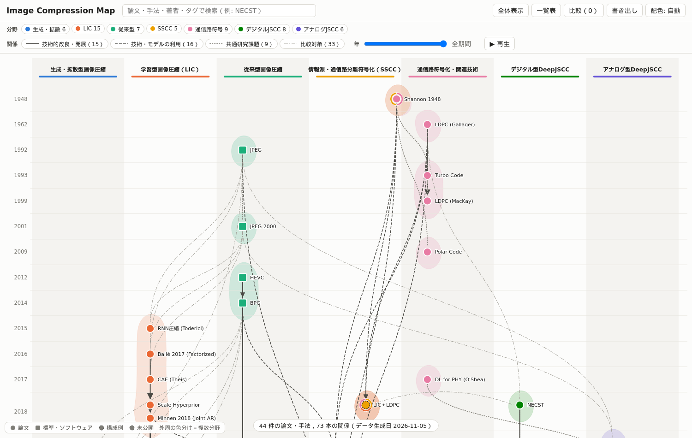
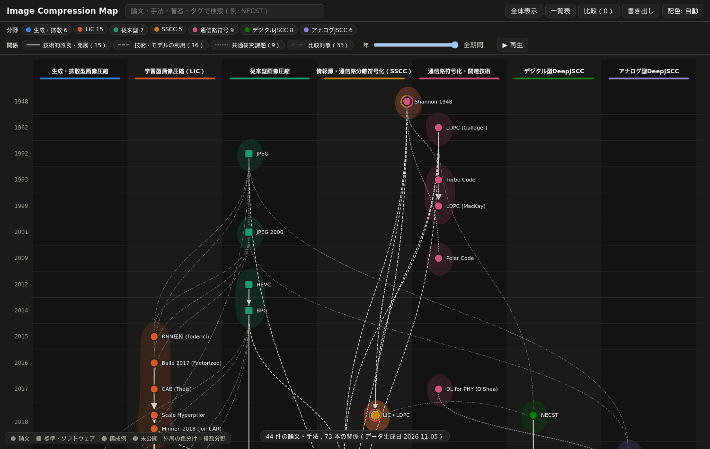
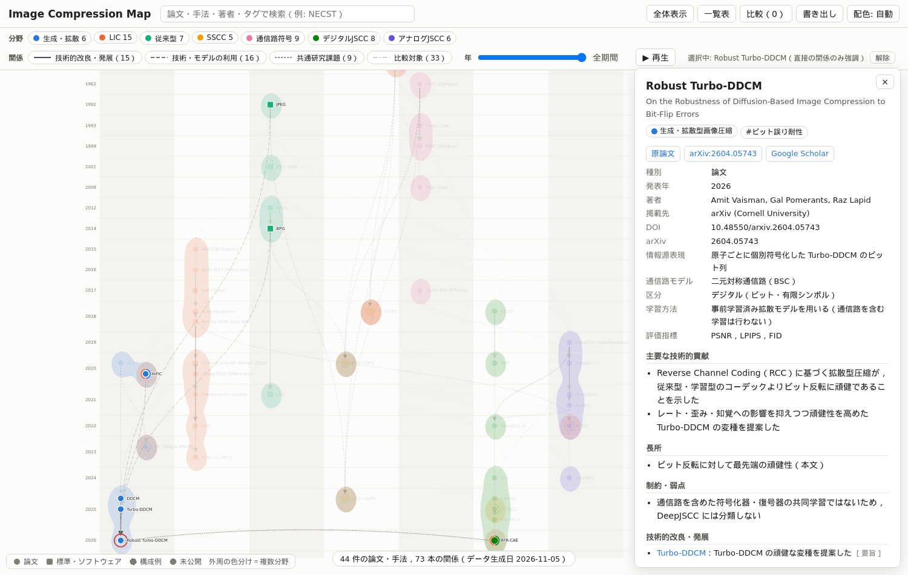
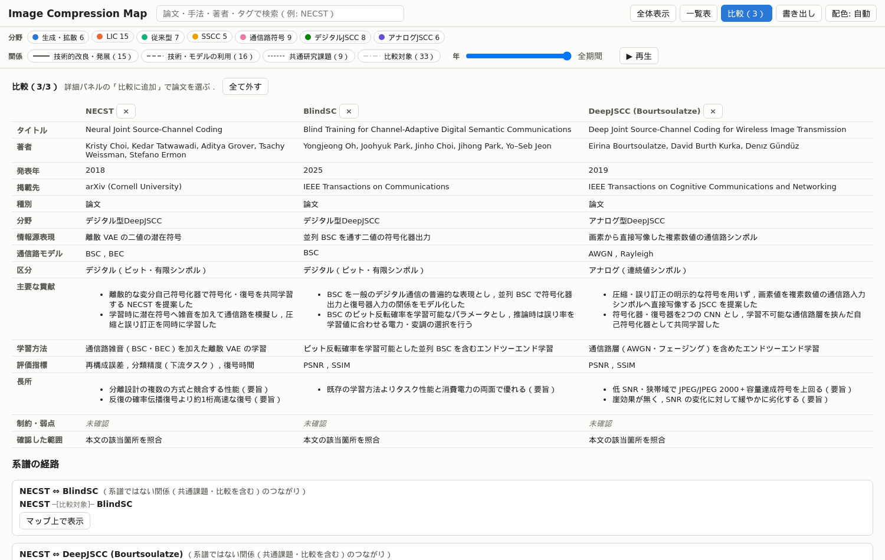
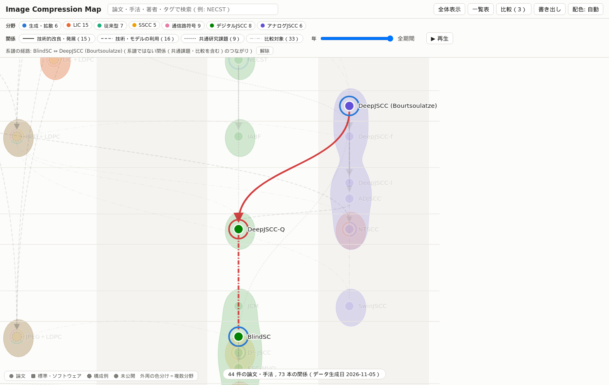

# report_001：画像圧縮・DeepJSCC研究系譜マップの開発

本レポートは，order_001 に基づき開発した研究系譜マップ（Image Compression Map）の実施内容，データの作成方法，検証結果，未解決の論点をまとめたものである．
サイトはローカルで動作と表示テストを確認した段階であり，GitHub リポジトリの作成・push・GitHub Pages への実際のデプロイは行っていない．

## 1. 参考リポジトリの調査と設計の方針

`yryo1005/optimizer_map`（コミット b6f3b3a）を調査した．同リポジトリは D3 v7 による描画，年を縦軸・分野グループを横軸とする配置，ガウス関数の等高線による分野範囲，詳細パネル，比較と系譜の経路，年スライダー，手法ごとの JSON，Python による検証，Playwright の E2E テスト，GitHub Actions によるデプロイを備える．
同リポジトリには LICENSE ファイルが無く再利用条件が明示されていないため，コードは複製せず，以下の設計の考え方のみを参考に新規実装した．

| 項目 | 踏襲した点 | 変更した点 |
| :--- | :--- | :--- |
| ノード | 手法ごとの JSON | 論文の書誌情報を API 由来の `survey/library.json` から転記し，未確認の項目は `null` とする．論文以外（標準，ソフトウェア，構成例，未公開）を `kind` で区別する |
| エッジ | 派生元を各ノードに記述 | 4種類（改良・発展，利用，共通課題，比較対象）に分け，各エッジに根拠（要旨・本文等）を必須とする |
| 配置 | 年の行×分野の列 | 力学計算をやめ，ラベル幅を考慮した行内の段組みで重なりを防ぐ．副分野は隣り合う列の場合のみ位置に反映する |
| 分野の重なり | 等高線による範囲 | 範囲に加え，ノード外周の色分けリングで複数分野を表す |
| 検証 | Python の検証スクリプト | JSON スキーマ（jsonschema）と書誌情報の照合を追加した |
| テスト | Playwright（Node.js） | Node.js が無い環境のため Python 版 Playwright とし，GitHub Pages と同じサブパスで配信して確認する |
| 依存 | CDN の D3 | D3 をサイトに同梱し，CDN に依存しない |

## 2. 論文データの作成

order が言及する Deep Research の調査結果はプロジェクト内に存在しなかったため，order に列挙された論文を起点とした．
書誌情報は ai-survey-kit の `surveykit.py add --title` により OpenAlex から取得し，39件を `survey/library.json` に登録した（途中で OpenAlex・arXiv の HTTP 429 が発生したため，間隔を空けて再取得した）．
各論文の内容は，要旨と，arXiv 等から取得した本文（30件，ローカルの PDF 2件を含む）の該当箇所の照合に基づいて記入した．BPG は公式ページと libbpg のソース，BFR-CAE は研究プロジェクトの文書（`../autoencoder/README.md`，`../bfr-cae-research/document.md`）に基づく．

| 項目 | 件数 |
| :--- | :--- |
| ノード | 44件（論文35，標準規格の解説論文4，公開ソフトウェア1，SSCC の構成例3，未公開1） |
| 分野ごとの所属（重複あり） | LIC 15，通信路符号 9，デジタル型 DeepJSCC 8，従来型 7，生成・拡散 6，アナログ型 DeepJSCC 6，SSCC 5 |
| 複数分野に属するノード | 9件（例: NTSCC は LIC とアナログ型 DeepJSCC，HiFiC・CDC は生成型と LIC，D²-JSCC はデジタル型 DeepJSCC と SSCC） |
| エッジ | 73本（比較対象33，利用16，改良・発展15，共通課題9） |
| エッジの根拠 | 本文47，要旨22，プロジェクト文書3，公式ページ1 |
| ノードの確認範囲 | 本文の該当箇所を照合33，要旨のみ9，公式ページ1，プロジェクト文書1 |

order の学術的な注意点は以下のようにデータへ反映し，`tests/test_validate_data.py::test_academic_constraints` で検査している．

- JPEG＋LDPC，BPG＋LDPC，LIC＋LDPC は，論文中で実際に比較対象として用いられた構成（BlindSC，NTSCC，DeepJSCC-f，DeepJSCC-Q，SwinJSCC，NECST の本文で確認）を SSCC の構成例として登録した．
- DDCM，Turbo-DDCM，Robust Turbo-DDCM は生成・拡散型画像圧縮のみに属し，DeepJSCC には属さない．
- Robust Turbo-DDCM と BFR-CAE は `related`（ビット誤り耐性）のみで結んだ．BFR-CAE は BSC を含む共同学習を根拠にデジタル型 DeepJSCC（副分野 LIC）とした．
- 系譜のエッジは論文中の明示（例: Scale Hyperprior の本文 "we extend the model presented in Ballé et al. (2017)"）を根拠とし，根拠が弱い場合は `related` または `compared_with` に留めた．例えば ADJSCC と DeepJSCC は `related`，D²-JSCC と DeepJSCC は要旨の "classic deep JSCC" が特定の論文を指すか確認できないため `related` とした．

API の応答に以下の誤りを確認した．`library.json` は書き換えず，ノードの `year_note`・`verification.notes` に記録した．

| 文献 | 内容 | 対応 |
| :--- | :--- | :--- |
| Turbo 符号（berrou2002near） | 発行年が 2002 だが DOI は ICC 1993 を指す | マップ上の年を 1993 とした |
| DDPM（ho2020denoising） | 要旨が別の文献（DiffuCpG）の内容に置き換わっている | arXiv の要旨ページと本文で内容を確認した |
| Turbo-DDCM（amit2025turboddcm） | 引用キーが第一著者の名（Amit）から生成されている | 表示に影響しないため注記のみ |
| CVPR の論文 | 掲載先名が重複して連結されている | `tools/common.py::clean_venue` で整理して表示する |

## 3. サイトの実装

`site/` は D3.js v7.9.0 による静的サイトであり，`site/data/graph.json` のみを読み込む．order の必須機能と優先度の高い追加機能を全て実装した．
図1はライトモードの初期表示，図2はダークモードである．縦軸が発表年，横軸が分野の列であり，Shannon 1948（通信路符号と SSCC）が2つの列の境界に置かれ，外周の色分けで複数分野を示している．





図3は URL `#robust_turbo_ddcm` で開いた状態である．選択した論文と直接の関係（Turbo-DDCM からの改良，DDCM・HiFiC・JPEG・BPG との比較，BFR-CAE との共通課題）のみを強調し，詳細パネルに書誌情報・外部リンク・各項目を表示する．



図4は NECST，BlindSC，DeepJSCC の比較表，図5はそのうち BlindSC と DeepJSCC の経路をマップ上に表示した状態である．この2論文の間には系譜の経路が無く，DeepJSCC-Q を介した「改良・発展」と「比較対象」のつながりであることが経路の種類として明示される．





初版では力学計算による配置で同じ年の論文とラベルが重なり，また凸包による分野範囲が離れた論文（Shannon 1948 等）に引き伸ばされて大きく重なった．そこで，ラベル幅を考慮した段組みと，ガウス関数の和の等高線による局所的な範囲に変更した．
さらに，副分野の列が離れている場合に加重平均で無関係な列に置かれる問題（Shannon 1948 がデジタル型 DeepJSCC の列に置かれた）があったため，共起の多い分野が隣り合う列順（生成・拡散，LIC，従来型，SSCC，通信路符号，デジタル型，アナログ型）に変更し，隣り合う列の副分野のみを位置に反映するようにした．
配色は dataviz の検証済みパレットの先頭7色を列順に割り当てている．隣り合う列の色の組は検証済みの隣接ペアに対応するが，7色すべての組の判別性は保証されないため，列見出し・凡例・詳細パネルの文字で分野を併記している．

## 4. 検証とテストの結果

CI と同じ手順をローカルで実行した結果を示す．

```text
[sync] 不一致 0 件，エラー 0 件
[validate] nodes=44 edges=73 errors=0 warnings=0
[build] site/data/graph.json: nodes=44 edges=73
25 passed in 5.76s
```

`tests/test_validate_data.py`（13件）は，実データの合格に加え，スキーマ違反，重複 ID，存在しない参照先，未定義のエッジ種別，自己参照，系譜の循環，比較対象の循環の許容，書誌情報の不一致，`year_note` の欠落，論文の `bib_key` の欠落を人工的に作って検出できることを確認する．
`tests/test_site.py`（12件）は，サブパス `/image-compression-map/` で配信したサイトについて，全ノード・エッジ・列・行・範囲の描画，URL による選択と外部リンク，未確認の表示，クリック選択と URL の更新，検索，分野・エッジ・年の絞り込み，比較と経路，配色，SVG／PNG の書き出し，ホイールによる拡大を確認し，コンソールのエラーが無いことを確認する．

## 5. 未解決の論点

- **GitHub Pages での実際の表示確認**：リポジトリの作成と push を行っていないため，Actions の実行と Pages 上の表示は未確認である．ローカルでは同じサブパスで表示テストを行った．
- **survey の検証**：`surveykit.py check` は，ノート（`survey/notes/`），比較表，調査報告が未作成であるため，エラー42件・警告5件となる．本プロジェクトでは `data/nodes/*.json` が各文献のノートの役割を担っており，survey の様式のノートは作成していない．
- **本文の照合の範囲**：ノードの内容は本文の該当箇所の照合に基づき，全文の精読ではない．要旨のみのノードが9件あり，D²-JSCC は arXiv 版を特定しておらず，通信路符号・通信路モデル・学習方法・評価指標が未確認である．Turbo 符号の評価通信路も未確認である．
- **ADJSCC の基礎とした構造**：本文の参考文献 [31] の書誌を抽出できず，本文の説明から DeepJSCC-f と判断した．
- **構成例の年**：SSCC の構成例と BFR-CAE は発表年を持たないため，比較対象として用いた論文の年（BFR-CAE は研究基盤の整備年）に置いた．年スライダーではその年に出現する．
- **ライセンス**：本リポジトリのコードとデータのライセンスは未設定である．公開前に決める必要がある．
- **収録範囲**：order の対象のうち，各分野の代表的な論文に限られる．DeepJSCC の派生研究（MIMO，OFDM，映像），LIC の可変レート・GAN 以外の知覚最適化，Polar 符号の5G規格化などは未収録である．

## 6. 次に検討すべき作業の候補

1. GitHub リポジトリ `image-compression-map` を作成して push し，Pages の Source を GitHub Actions に設定して，Actions の成功と Pages 上の表示を確認する（ユーザーの確認が必要）．
2. 要旨のみの9件（特に D²-JSCC）について本文を確認し，未確認の項目を埋める．
3. `surveykit.py snowball` で DeepJSCC（bourtsoulatze2019deep）・NECST（choi2018neural）・DDCM（ohayon2025compressed）の被引用文献を収集し，デジタル型 DeepJSCC とビット誤り耐性の研究を追加する．
4. order の将来的な拡張（Semantic Scholar の引用数によるノードの大きさ，arXiv の候補収集，分野別の年次トレンド，課題タグによる検索）を実装する．課題タグは `tags`（現在は「ビット誤り耐性」等）の語彙を定めることで検索に利用できる．
5. ライセンスを決め，`LICENSE` を追加する．
