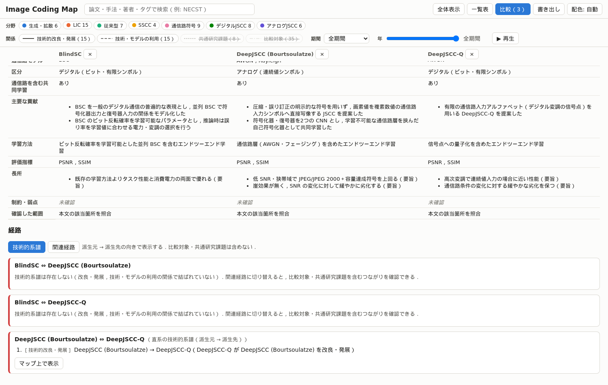
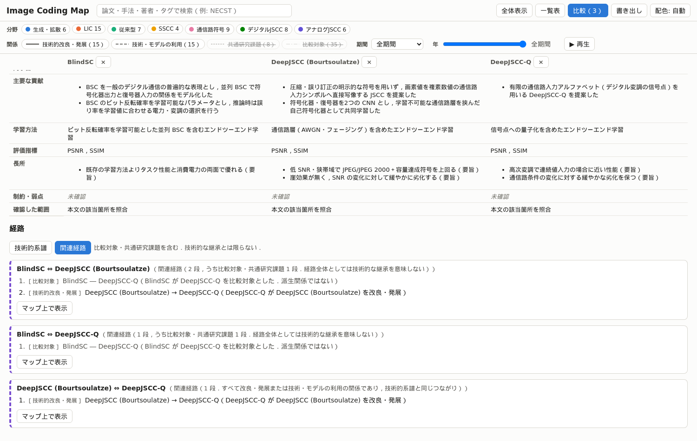
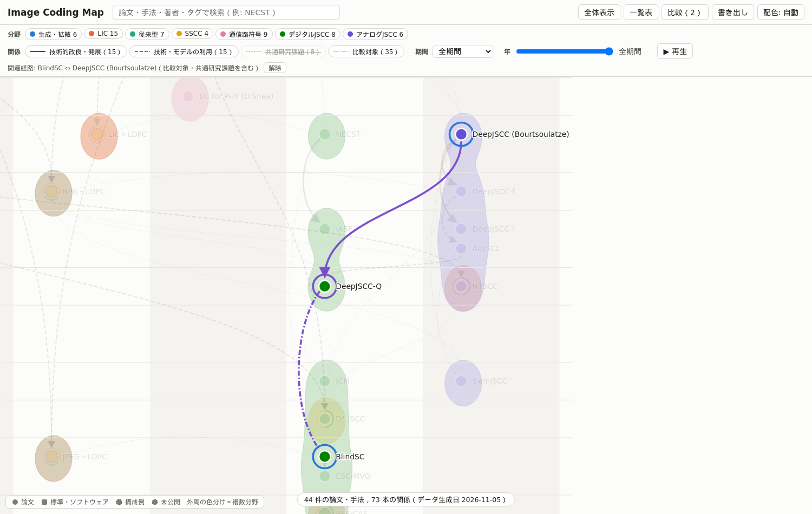
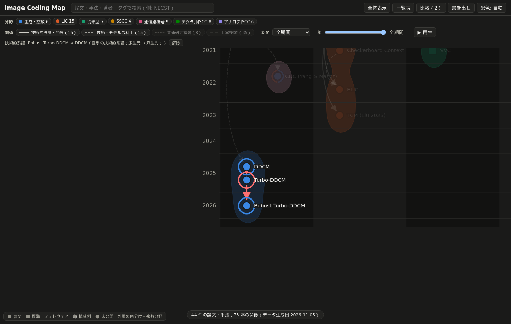
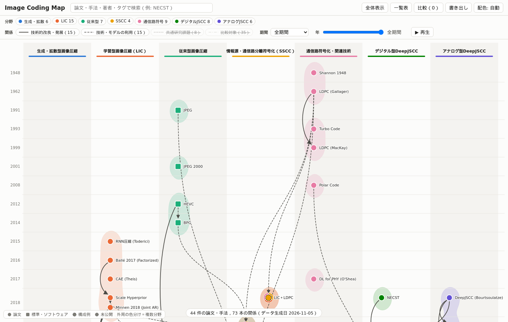
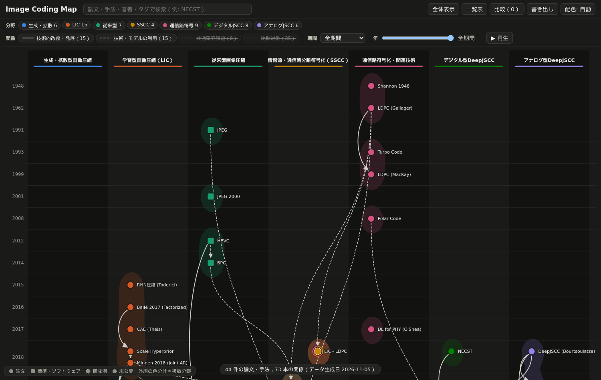
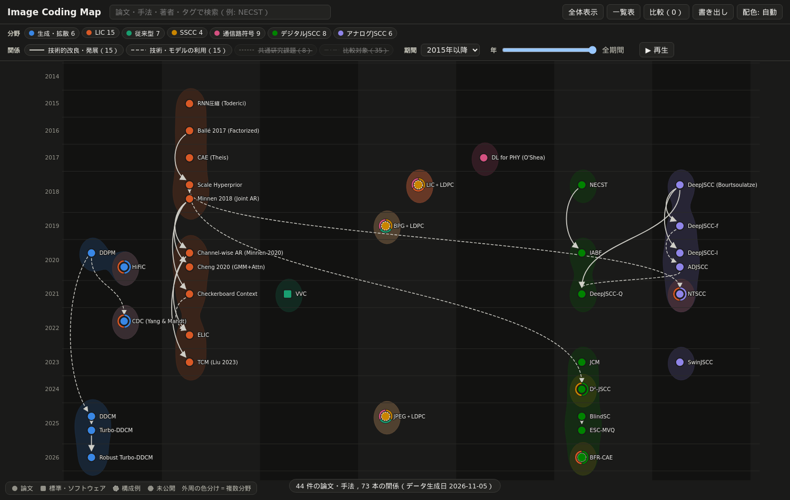
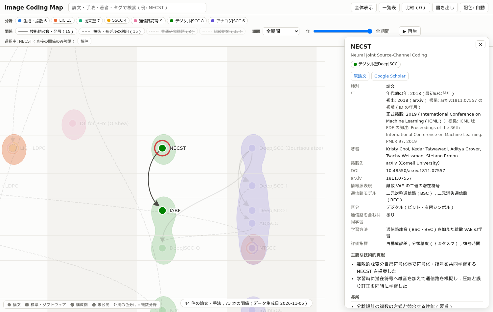

# Report 002：研究系譜の正確性改善とプロジェクト名の変更

本レポートは，order_002 に基づき，研究系譜マップの名称を Image Coding Map に変更し，論文データの正確性，年の扱い，経路表示，分類，表示を改善した結果をまとめたものである．
GitHub のリポジトリ作成・push・Pages へのデプロイと commit は行っていない．

## 1. 名称変更

プロジェクト名を Image Coding Map，リポジトリ名と GitHub Pages のサブパスを `image-coding-map`（`/image-coding-map/`）に統一した．ローカルのディレクトリは既に `image-coding-map` であったため移動していない．

| ファイル | 変更内容 |
| :--- | :--- |
| `site/index.html` | `<title>` と見出し |
| `site/assets/app.js` | 先頭のコメント，SVG／PNG の保存ファイル名（`image-coding-map.svg`／`.png`） |
| `site/assets/layout.js`，`site/assets/style.css` | 先頭のコメント |
| `tests/test_site.py` | 配信するサブパス（`PREFIX = "/image-coding-map/"`） |
| `data/schema/node.schema.json` | `$id` |
| `README.md`，`document.md` | 名称，リポジトリ名，サブパス |

`.github/workflows/pages.yml` は名称に依存しないため変更していない．`.orders/` と `.reports/report_001.md` は作業の履歴であるため旧名称のまま残した．`tests/test_validate_data.py::test_no_old_project_name` で，履歴とテスト自身を除くファイルに旧名称が残っていないことを検査している．

## 2. 論文データの検証結果

### 2.1 本文の取得と照合

report_001 で要旨のみとした9件について本文の取得を試みた．取得できたのは Shannon 1948（Bell System Technical Journal の訂正付き再録版，55ページ）と D²-JSCC（arXiv:2403.07338）の2件である．その他は所在先が自動アクセスを拒否したか，所在先の文書が別の文献（Gallager の所在は学位論文，MacKay の所在は Electronics Letters の別論文）であったため，要旨のみのまま残した．

| ノード | 結果 |
| :--- | :--- |
| Shannon 1948 | 本文で Theorem 9（雑音のない通信路の基本定理），Theorem 11（雑音のある離散通信路の基本定理），Theorem 17（白色熱雑音の通信路容量 $` C = W \log ((P+N)/N) `$）を確認し，貢献・通信路モデル・制約（Sec. 14）を記入した |
| D²-JSCC | 本文で，通信路が AWGN とブロックレイリーフェージング（チャネル反転電力制御），通信路符号が Polar 符号（aff3ct，BPSK／QPSK），情報源符号化が Scale Hyperprior [25]，学習方式が学習済みモデルの選択と情報源符号化器の再学習の2段階，評価指標が PSNR，比較対象が DeepJSCC [18] と NTSCC [17] であることを確認した |
| JPEG，JPEG 2000，HEVC，VVC，Turbo 符号，LDPC（Gallager），LDPC（MacKay） | 本文を取得できず，要旨のみの確認のまま残した |

### 2.2 修正した学術情報とその根拠

| 対象 | 修正前 | 修正後 | 根拠 |
| :--- | :--- | :--- | :--- |
| Cheng 2020 → Minnen 2018 の根拠 | 参考文献 [21] を Minnen et al. と判断 | [20] が Minnen et al. | 本文: "Minnen et al. [20] and Lee et al. [21]"，"[20] proposed ... an autoregressive context model ... and a mean and scale hyperprior" |
| ADJSCC の基本構造 | [31] を本文の説明から DeepJSCC-f と推定 | [31] = DeepJSCC-f と確定 | 参考文献リスト: "[31] ——, Deepjscc-f: Deep joint source-channel coding of images with feedback" |
| Channel-wise AR → Minnen 2018 | 要旨の "context-adaptive baseline" | 本文で確定 | 本文: "6.7% over the context-adaptive baseline [13]"，[13] = Minnen et al. |
| D²-JSCC の関係 | DeepJSCC と `related` | DeepJSCC・NTSCC と `compared_with`，Scale Hyperprior・Polar 符号を `builds_on` | 2.1 の本文の照合 |
| JPEG の初出年 | 1992（IEEE TCE） | 1991 | Crossref: 同名・同著者の論文が Communications of the ACM（1991年4月，DOI 10.1145/103085.103089）に掲載 |
| Shannon 1948 の分野 | 通信路符号化・関連技術＋SSCC | 通信路符号化・関連技術のみ | 情報理論の基礎研究であり，特定の SSCC の実装方式ではない |
| 構成例 → Shannon 1948 | `builds_on` 3本 | 削除 | 根拠とした本文（BlindSC，NTSCC，NECST）は分離設計に言及するが，Shannon 1948 を部品として用いていない |

各エッジの参考文献番号は，Scale Hyperprior，Minnen 2018，Checkerboard（[26]），ELIC（[24]，[40]），TCM（[27]），HiFiC（[32]，[7]），DeepJSCC-f（[42]），DeepJSCC-l（[17]），DeepJSCC-Q（[2]，[7]，[8]，[14]），SwinJSCC（[6]），BlindSC（[15]），NTSCC（[39]，[28]）について参考文献リストと照合し，不一致が無いことを確認した．

### 2.3 書誌情報の不整合

| 文献 | 内容 | 対応 |
| :--- | :--- | :--- |
| Turbo 符号 | OpenAlex の発行年 2002，DOI は ICC 1993 | 初出・正式掲載を 1993 とし，`year_note` に記録（report_001 から継続） |
| DDPM | OpenAlex の要旨が別の文献の内容 | arXiv で確認した内容を維持（継続） |
| D²-JSCC | OpenAlex の著者名 "Chuan Zhen Huang"，arXiv 版では "Chuan Huang"．プレプリント（huang2024d2jscc）が別の文献として登録された | プレプリントを「同一論文」として除外し，初出の根拠としてのみ参照．著者名の揺れは `verification.notes` に記録 |
| 著者名の表記 | 「姓, 名」と「名 姓」が混在（CAE，DDCM，DDPM，Scale Hyperprior，Turbo-DDCM） | 表示用に「名 姓」へそろえる処理を `tools/common.py::normalize_author` に追加（`library.json` は変更しない） |
| DeepJSCC-f のタイトル | "DeepJSCC- f :" のように空白が入る | API の値のまま表示（未修正） |

D²-JSCC の arXiv 版を検索した際に，関係の無い4件が候補としてライブラリに登録されたため，理由を付けて除外した．`survey/library.json` は44件（採録39件，除外5件）である．

## 3. 年の扱い

年代軸の `year` の意味を `year_basis` で定義し，初出と正式掲載を `publication` に分けて記録した．

| 種別 | `year_basis` | `year` の意味 |
| :--- | :--- | :--- |
| 論文 | `first_public` | 最初の公開年．arXiv 初版（ID の年月）と正式掲載の早い方 |
| 標準規格 | `standard_overview` | 解説論文の最初の公開年（制定年ではない） |
| ソフトウェア | `software_release` | 最初の公開版の年 |
| 構成例 | `scheme_first_use` | 比較対象として最初に用いた収録論文の初出年 |
| 未公開研究 | `unpublished_placement` | 配置のための研究開発年（発表年として表示しない） |

正式掲載は39件について記録した．`library.json` が arXiv の記録のみであった11件は，本文のヘッダ・脚注（例: "Published as a conference paper at ICLR 2017"，"Proceedings of the 36th International Conference on Machine Learning, PMLR 97, 2019"，CVF の Open Access 版の注記）と arXiv のコメント（DDCM: "Published in the International Conference on Machine Learning (ICML) 2025"）で確認した．DBLP の API はボット対策のため利用していない．
年を変更したノードは以下の13件である．

| ノード | 変更 | 理由 |
| :--- | :--- | :--- |
| DeepJSCC（Bourtsoulatze） | 2019 → 2018 | arXiv:1809.01733（正式掲載 2019） |
| DeepJSCC-f | 2020 → 2019 | arXiv:1911.11174 |
| DeepJSCC-l | 2021 → 2020 | arXiv:2009.12480 |
| ADJSCC | 2021 → 2020 | arXiv:2012.00533 |
| NTSCC | 2022 → 2021 | arXiv:2112.10961 |
| DeepJSCC-Q | 2022 → 2021 | arXiv:2111.13042 |
| SwinJSCC | 2024 → 2023 | arXiv:2308.09361 |
| JCM | 2024 → 2023 | arXiv:2310.06690 |
| D²-JSCC | 2025 → 2024 | arXiv:2403.07338 |
| CDC | 2023 → 2022 | arXiv:2209.06950 |
| Polar 符号 | 2009 → 2008 | arXiv:0807.3917 |
| JPEG | 1992 → 1991 | CACM 1991 |
| BPG＋LDPC | 2020 → 2019 | 比較に最初に用いた DeepJSCC-f の初出年に連動 |

NECST は年代軸の年が 2018（arXiv）であり，詳細パネルに「初出: 2018（arXiv）」と「正式掲載: 2019（ICML）」を併記する（図4）．BFR-CAE は「発表年: 未公開」と表示し，年代軸上の位置が研究開発年による配置であることを注記する．ツールチップ・一覧表でも「未公開」と表示する．年スライダーと表示期間は `year` で判定する．
検証では，初出年と `year` の一致，正式掲載年 ≥ 初出年，初出年 ≤ arXiv 初版の年，種別と `year_basis` の対応，構成例の年，未公開研究・構成例が初出・正式掲載を持たないこと，同じ論文（`bib_key`，arXiv ID，DOI，タイトル）の重複を検査する．

## 4. 系譜経路と関連経路の分離

比較画面の「経路」に「技術的系譜」（初期状態）と「関連経路」の切り替えを設けた．

| 経路 | 実装（`site/assets/app.js`） | 表示 |
| :--- | :--- | :--- |
| 技術的系譜 | `findTechnicalLineage`: `edge_types.json` で `lineage: true` の種別（`derived_from`，`builds_on`）のエッジのみを，新しい手法 → 元の手法の向きにたどる幅優先探索．(1) 一方が他方の祖先である直系の経路，(2) 両者から上へたどった距離の和が最小の共通の派生元を経由する2本の経路，の順に探す | 各段を「派生元 → 派生先」で示す．無い場合は「技術的系譜は存在しない」と表示し，マップ上の表示ボタンを出さない．マップ上は赤 |
| 関連経路 | `findRelatedPath`: 4種類全てのエッジを向きを無視してたどる幅優先探索 | 各段の関係の種類を示し，比較対象・共通研究課題の段に「派生関係ではない」と明記する．マップ上は紫で，エッジの線種は関係の種類のまま |

ノード選択時の直接関係の強調は従来どおり動作する．BlindSC と DeepJSCC（Bourtsoulatze）では，技術的系譜は存在せず，関連経路では「BlindSC が DeepJSCC-Q を比較対象とした」と「DeepJSCC → DeepJSCC-Q（改良・発展）」の2段となる（図5，図6）．
`tests/test_site.py::test_lineage_never_uses_non_lineage_edges` は，全ての論文の組（946組）で技術的系譜が `derived_from`・`builds_on` のみを用い，各段の向き（派生元 → 派生先）がエッジの向きと年の順に一致すること，関連経路が4種類全ての関係を探索することを確認する．









## 5. 分類の再確認

全44ノードの分野を確認し，Shannon 1948 を SSCC から外した（2.2）．その他の分類は以下の理由で維持した．

- NTSCC（アナログ型 DeepJSCC＋LIC），HiFiC・CDC（生成型＋LIC），BFR-CAE（デジタル型 DeepJSCC＋LIC）により，LIC と DeepJSCC が排他的でないことを表す．
- DDCM，Turbo-DDCM，Robust Turbo-DDCM は生成・拡散型のみとした．通信路を含む共同学習を行わない（`joint_channel_training: false`）ためである．
- JPEG は従来型画像圧縮，LDPC は通信路符号であり，JPEG＋LDPC 等の構成例は `kind: scheme` として論文と区別し，書誌情報を持たない．
- D²-JSCC はデジタル型 DeepJSCC と SSCC（情報源符号と通信路符号を分けたうえでレートを共同最適化する）に属するとした．通信路の誤りを学習に含めるかは未確認のため `joint_channel_training: null` とし，検証で警告を出す．
- BFR-CAE の分類根拠（BSC を含む合成損失による共同学習，圧縮自己符号化器であること）を `verification.notes` に明記した．

分類の規則を `data/classification_rules.json` に定義し，検証に組み込んだ．規則は，DeepJSCC に属するノードが `joint_channel_training: false` でないこと，アナログ型・デジタル型 DeepJSCC の区分，構成例の主分野と書誌情報，情報理論の基礎研究を SSCC にしないこと，種別ごとの年の基準である．`joint_channel_training`（通信路を含む共同学習の有無）をスキーマに追加し，全ノードに記入した．
`tests/test_validate_data.py` では，Robust Turbo-DDCM をデジタル型 DeepJSCC にした場合，DeepJSCC をデジタルの区分にした場合，Shannon 1948 を SSCC にした場合，構成例の主分野を変えた場合，派生元が派生先より新しい場合をそれぞれ検出できることを確認している．

## 6. 表示の改善

- `edge_types.json` に `default_visible` を追加し，初期表示を `derived_from`・`builds_on` のみとした（図1）．比較対象（35本）・共通研究課題（8本）は凡例のボタンで表示できる．
- 「期間」の選択（全期間／2015年以降／2020年以降）を追加した．選択した期間の論文だけを表示して拡大し，年スライダーと併用できる（図3）．
- 同じ列で間に他の論文を挟む縦のエッジを横へ膨らませ，途中のノードを経由しているように見えないようにした（例: LDPC（Gallager）→ LDPC（MacKay）が Turbo 符号の上を通らない）．
- 比較表の見出しの固定表示の透けを修正し，「掲載先」を「掲載先（登録した版）」に改めた．
- ノードとラベルの重なりが無いことと，ラベルの文字と背景の対比（4.5 以上）を，ライト・ダークの両方でテストした．









## 7. テスト結果

CI と同じ手順をローカルで実行した結果を示す．

```text
[sync] 不一致 0 件，エラー 0 件
[warn]  d2jscc.json: joint_channel_training が未確認（jscc_requires_joint_training）
[validate] nodes=44 edges=73 errors=0 warnings=1
[build] site/data/graph.json: nodes=44 edges=73
43 passed in 8.88s
```

テストは25件から43件になった．order_002 の検証項目との対応は以下の通りである．

| 検証項目 | テスト |
| :--- | :--- |
| 1. 旧名称の残存 | `test_no_old_project_name` |
| 2. `/image-coding-map/` での表示 | `test_site.py` の全テスト（サブパスで配信） |
| 3. 初出年と正式掲載年の区別 | `test_publication_years_in_panel`，`test_unpublished_has_no_publication_year`，`test_year_must_be_first_public`，`test_first_public_after_arxiv`，`test_formal_before_first_public`，`test_duplicate_preprint_and_formal` |
| 4．5. 技術的系譜と関連経路 | `test_lineage_never_uses_non_lineage_edges`，`test_blindsc_deepjscc_lineage_vs_related`，`test_compare_and_lineage_path` |
| 6. 不正な分類・参照の検出 | `test_rule_*`，`test_lineage_target_newer_is_error`，`test_scheme_year_follows_first_use` ほか |
| 7. 検索・比較・年スライダー・詳細パネル | `test_search`，`test_compare_and_lineage_path`，`test_year_slider`，`test_period_select`，`test_select_by_url_hash_and_external_links` |
| 8. ライト・ダーク | `test_no_overlap_and_contrast[light]`，`[dark]`，`test_theme_toggle` |
| 9. SVG・PNG の書き出し | `test_export_svg_and_png` |

## 8. 未確認のまま残した事項

- JPEG，JPEG 2000，HEVC，VVC，Turbo 符号，LDPC（Gallager），LDPC（MacKay）の7件は本文を取得できず，要旨のみの確認である．
- D²-JSCC が通信路の誤りを学習の順伝播に含めるか（`joint_channel_training: null`）．
- BPG の最初の版（0.9）の公開日．年はソースの著作権表記の年（2014）による．
- 標準規格そのものの制定年（VVC の 2020年7月を除く）．
- 制約・弱点は多くの論文で未確認のままである．本文の照合は該当箇所の検索によるもので，全文の精読ではない．
- `surveykit.py check` はノート・調査報告が無いためエラー42件・警告5件のままである（`data/nodes` がノートの役割を担う）．

## 9. GitHub Pages 公開前に残っている作業

1. GitHub リポジトリ `image-coding-map` の作成と push（ユーザーの確認が必要）．
2. Settings → Pages の Source を GitHub Actions にし，Actions の成功と `/image-coding-map/` での表示を確認する．
3. コードとデータのライセンスを決め，`LICENSE` を追加する．
4. `.ai/` のサブモジュールを公開リポジトリに含めるかを決める．

## 10. 次に検討すべき作業の候補

- 拡大時にも分野の列見出しが見えるよう，列見出しを画面上部に固定する（2015年以降の表示では列見出しが画面外になる）．
- 要旨のみの7件について，図書館経由などで本文を確認する．
- BPG＋Polar 符号（D²-JSCC の比較対象）など，未登録の構成例を追加するか検討する．
- order_001 の将来的な拡張（引用数，候補収集，年次トレンド，課題タグによる検索）．
