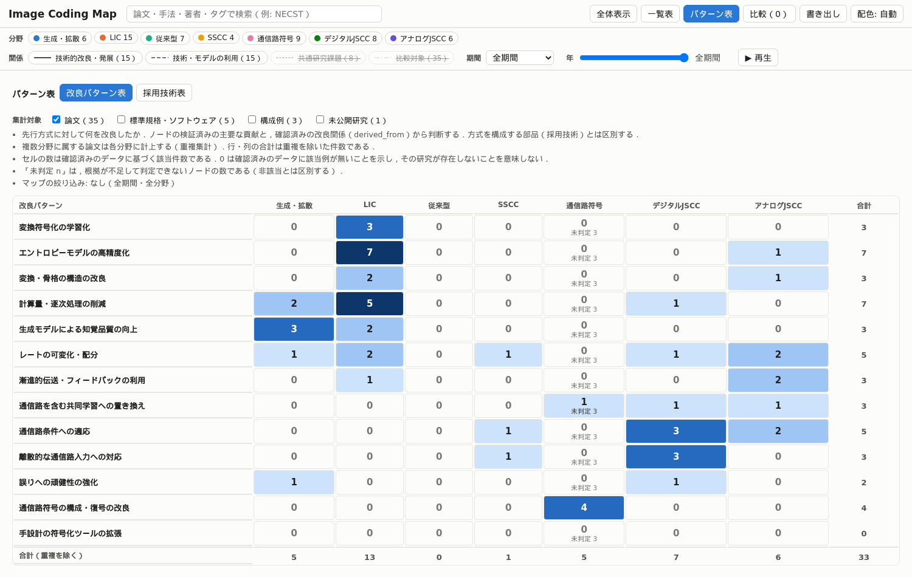
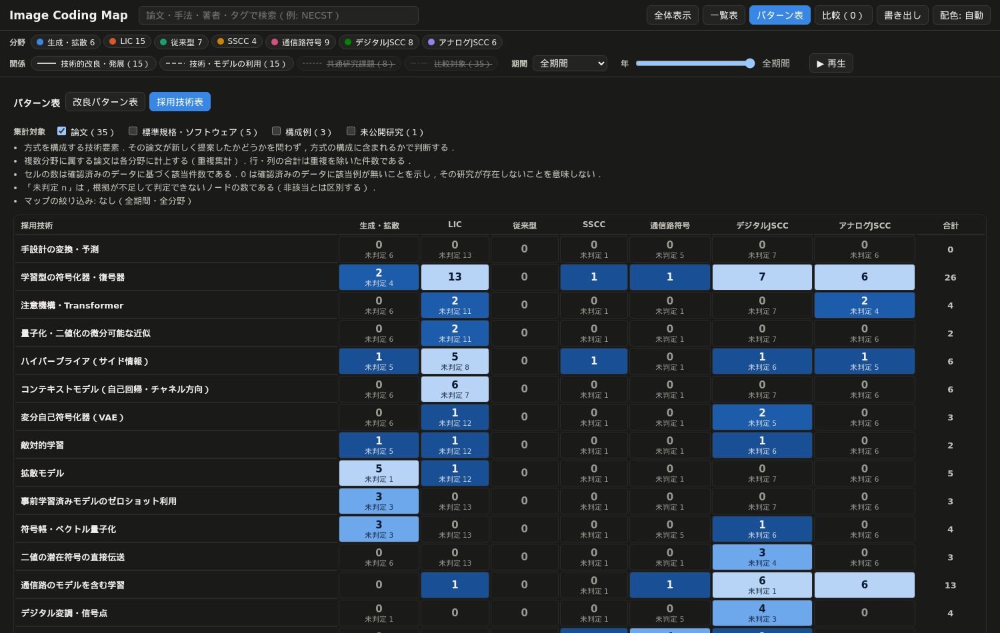
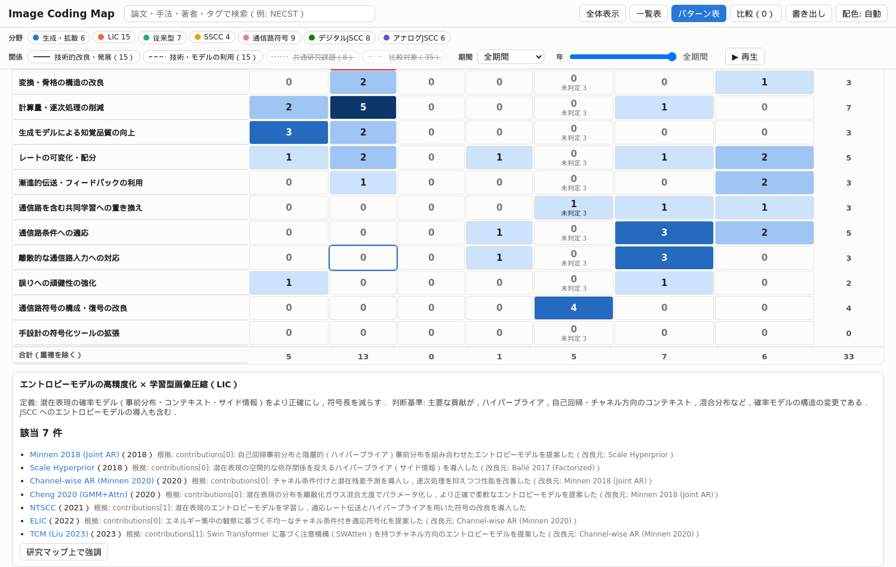
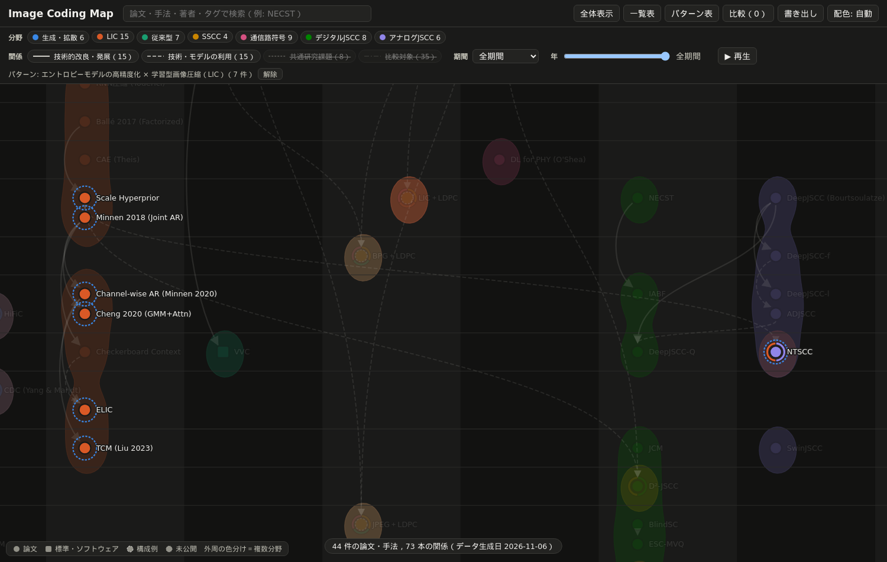
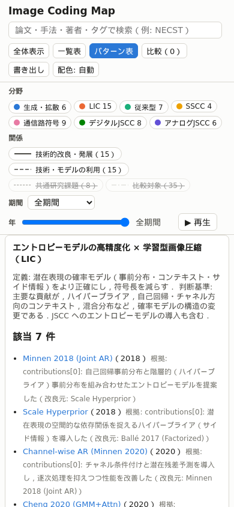

# report_005：技術・改良パターン表の設計と実装

本レポートは，order_005 に基づき，Image Coding Map に改良パターン・採用技術の分類体系とパターン表を追加した結果をまとめたものである．分類の詳細は `docs/pattern_taxonomy.md` に記載した．commit・push・デプロイは行っていない．

## 1. 参考リポジトリの調査

optimizer_map のパターン表は，改良パターン（15種）を派生エッジ（改良元 → 手法）に付け，「パターン × 分野グループ／年代」の表で集計し，未適用の組み合わせ（「＋」）から改善の候補を提案する構成である．ライセンスが確認できないためコードは複製せず，表の軸，セルの件数と色分け，セルからの一覧とマップの強調という UI の構造のみを参考にした．「＋」の提案機能は実装していない．

## 2. 分類の設計理由

既存44ノードの検証済みの記述には，「先行方式のどこを変えたか」と「何で構成されるか」の2種類の情報が含まれる．前者を改良パターン，後者を採用技術として別の軸で管理した．同じ軸にすると，部品（例: ハイパープライア）を用いただけの論文が，その部品による改良を行ったように見えるためである．
構成要素の層による単一の軸（案A），目的による単一の軸（案B），参考リポジトリの改良パターンの流用（案D）を比較し，改良と部品の2軸（案C）を採用した．案A では改良と部品が混ざり，案B では1つの論文が多くの行に該当して行の違いが手段を表さず，案D は対象分野が異なるためである．列は既存の7分野をそのまま用いた．マップの列・色・フィルタと対応させるためである．

採用した分類は，改良パターン13種と採用技術16種である．各パターンに ID，表示名，定義，判断基準，表示の順を設定し，採用技術の一部には，検証済みのフィールドから論理的に導ける非該当の条件（例: `training` が「学習なし」の方式は学習型の技術が非該当）を設定した．

## 3. データ構造

| ファイル | 内容 |
| :--- | :--- |
| `data/patterns.json` | 2つの軸（`improvements`，`techniques`）とパターンの定義，判定の状態の説明 |
| `data/nodes/<id>.json` の `patterns` | 軸ごとの判定の状態 `assessment`，理由 `note`，項目 `items`（`{id, evidence: {kind, detail}, from?}`） |
| `data/schema/node.schema.json` | `patterns` を必須キーとして追加 |
| `data/vocab.json` | 根拠の種類 `node_field`（ノードの検証済みの記述），`relation`（確認済みの関係）を追加 |

根拠は，ノードの検証済みの記述の該当箇所（例: `contributions[0]: 自己回帰事前分布と階層的…`）か，確認済みの関係（例: `relations（builds_on → minnen_joint）: …`）として記録し，パターン表の一覧と詳細パネルで確認できる．改良元が系譜の関係で確認できる改良には `from` を記録した（16件）．

ノードとパターンの組は「該当」「非該当」「未判定」の3値で判定する．判定済み（`assessed`）の軸で付与していないもの，対象外（`not_applicable`）の軸，定義の非該当の条件に一致するものを非該当とし，それ以外を未判定とする．判定の規則は `tools/patterns.py` と `site/assets/patterns.js` に同じものを実装した．

## 4. 各パターンの適用件数

全44ノードに対する件数を示す（論文以外を含む．パターン表の初期状態は論文のみを集計する）．

| 改良パターン | 該当 | 未判定 | 採用技術 | 該当 | 未判定 |
| :--- | ---: | ---: | :--- | ---: | ---: |
| 変換符号化の学習化 | 3 | 7 | 手設計の変換・予測 | 7 | 36 |
| エントロピーモデルの高精度化 | 7 | 7 | 学習型の符号化器・復号器 | 28 | 4 |
| 変換・骨格の構造の改良 | 3 | 7 | 注意機構・Transformer | 4 | 28 |
| 計算量・逐次処理の削減 | 7 | 7 | 量子化・二値化の微分可能な近似 | 3 | 29 |
| 生成モデルによる知覚品質の向上 | 3 | 7 | ハイパープライア | 6 | 26 |
| レートの可変化・配分 | 5 | 7 | コンテキストモデル | 6 | 26 |
| 漸進的伝送・フィードバックの利用 | 4 | 6 | 変分自己符号化器 | 3 | 29 |
| 通信路を含む共同学習への置き換え | 4 | 7 | 敵対的学習 | 2 | 30 |
| 通信路条件への適応 | 5 | 7 | 拡散モデル | 5 | 27 |
| 離散的な通信路入力への対応 | 3 | 7 | 事前学習済みモデルのゼロショット利用 | 3 | 29 |
| 誤りへの頑健性の強化 | 4 | 6 | 符号帳・ベクトル量子化 | 4 | 39 |
| 通信路符号の構成・復号の改良 | 4 | 4 | 二値の潜在符号の直接伝送 | 4 | 28 |
| 手設計の符号化ツールの拡張 | 2 | 5 | 通信路のモデルを含む学習 | 14 | 1 |
| | | | デジタル変調・信号点 | 4 | 13 |
| | | | 誤り訂正符号 | 8 | 9 |
| | | | 確率的・逐次的な通信路復号 | 4 | 13 |

軸の判定の状態は，改良パターンが判定済み31件・部分判定6件・対象外6件・未判定1件，採用技術が部分判定43件・対象外1件である．改良パターンは各2〜7件であり，極端な偏りは無い．

## 5. 未判定の項目

- **改良パターン**：要旨のみのノード（JPEG 2000，HEVC，VVC，Turbo 符号，LDPC（Gallager，MacKay））は部分判定であり，挙げていない改良は未判定である．JPEG は先行方式との比較を確認していないため全て未判定とした．
- **採用技術**：構成要素を網羅的に確認したノードが無いため，Shannon 1948 を除く全ノードを部分判定とした．そのため，採用技術表には未判定が多い（例: LIC の論文の「手設計の変換・予測」は13件が未判定）．非該当は定義の非該当の条件から導けるもの（学習を行わない方式の学習型の技術，通信路を含む学習を行わない方式の「通信路のモデルを含む学習」等）に限っている．
- 検証済みの記述で裏付けられないため，JCM の「通信路条件への適応」，D²-JSCC の「デジタル変調・信号点」，DeepJSCC-Q の「量子化・二値化の微分可能な近似」は付与せず，未判定とした．

## 6. 実装内容

ツールバーに「パターン表」を追加した．表は以下の機能を持つ（図1〜図5）．

- 「改良パターン表」と「採用技術表」の切り替え．行の名前に定義と判断基準を表示する．
- セルに該当数と「未判定 n」を表示し，該当数を5段階の単一色相で色分けする（ライト・ダークで別の段階を用い，文字との対比を 4.5 以上とした）．
- 行・列・全体の合計（重複を除く）．複数分野の論文を各分野に計上することと，0件の意味（研究の不存在を意味しない）を表の上に明記した．
- 集計対象の切り替え（初期は論文のみ．標準規格・ソフトウェア，構成例，未公開研究を加えられる）．
- マップの表示期間・年スライダー・分野の絞り込みの反映（非表示の分野は列から除く）．表を開いたまま絞り込みを変えると再集計する．
- セル・行の選択による該当論文の一覧（根拠と改良元つき）と未判定の論文の一覧，「研究マップ上で強調」によるマップ上の強調と注記．
- 詳細パネルへの改良パターン・採用技術（根拠と判定の状態）の表示．
- スマートフォンの幅では表を横スクロールし，行の名前を固定する．











## 7. テスト結果

```text
[sync] 不一致 0 件，エラー 0 件
[warn]  d2jscc.json: joint_channel_training が未確認（jscc_requires_joint_training）
[validate] nodes=44 edges=73 errors=0 warnings=1
[build] site/data/graph.json: nodes=44 edges=73
63 passed in 12.92s
```

テストは43件から63件になった（`tests/test_patterns.py` 11件，`tests/test_site.py` に7関数・9件を追加）．order_005 の検証項目との対応を示す．

| 検証項目 | テスト |
| :--- | :--- |
| 1. パターン定義とノードの参照の整合 | `test_real_data_consistent`，`test_from_must_be_lineage`，`test_item_conflicts_with_condition`，`test_items_on_not_applicable_axis` |
| 2. 未定義・重複のパターン ID | `test_undefined_pattern_id`，`test_duplicate_pattern_in_node`，`test_duplicate_pattern_definition`，`test_invalid_condition_syntax` |
| 3. 未判定と非該当の区別 | `test_unknown_vs_not_applicable` |
| 4. セルの集計値と元データの一致 | `test_count_table_matches_raw`，`test_pattern_table_counts_match_data[improvements／techniques]`（ブラウザの全セルを Python の集計と照合） |
| 5. 複数分野の集計 | `test_count_table_multi_domain`，`test_pattern_cell_list_and_map_highlight`（NTSCC を LIC に計上） |
| 6. セルの選択と一覧・マップの強調 | `test_pattern_cell_list_and_map_highlight` |
| 7. 年代・分野のフィルタ | `test_pattern_table_follows_filters`，`test_pattern_kinds_toggle` |
| 8. ライト・ダーク | `test_pattern_table_theme_contrast[light／dark]`（最初の実行で，ライトモードの3段階目の文字の対比が 3.6 であることを検出し，色の段階を修正した） |
| 9. 既存機能 | 既存の43件（マップ，検索，比較，経路，詳細パネル，書き出し等） |
| 10. `/image-coding-map/` での動作 | `tests/test_site.py` の全テスト（サブパスで配信） |
| PC・スマートフォン | `test_pattern_table_mobile`（幅 390px で横スクロールとセルの選択） |

## 8. 今後の課題

- 採用技術は全て部分判定であり，未判定が多い．本文で構成要素を確認したノードから判定済みに改めると，非該当を表示できるようになる．
- 要旨のみのノード（7件）の改良パターンは部分判定のままである．
- order_004 で追加推奨とした論文（OFDM・MIMO の DeepJSCC，パケット損失耐性の LIC 等）を収録する際に，既存の行で表せるかを確認し，必要なら行を追加する（`docs/pattern_taxonomy.md` の 5.3）．
- 参考リポジトリにある年代を列とする表は実装していない．年代の絞り込みは表示期間・年スライダーで行う．
