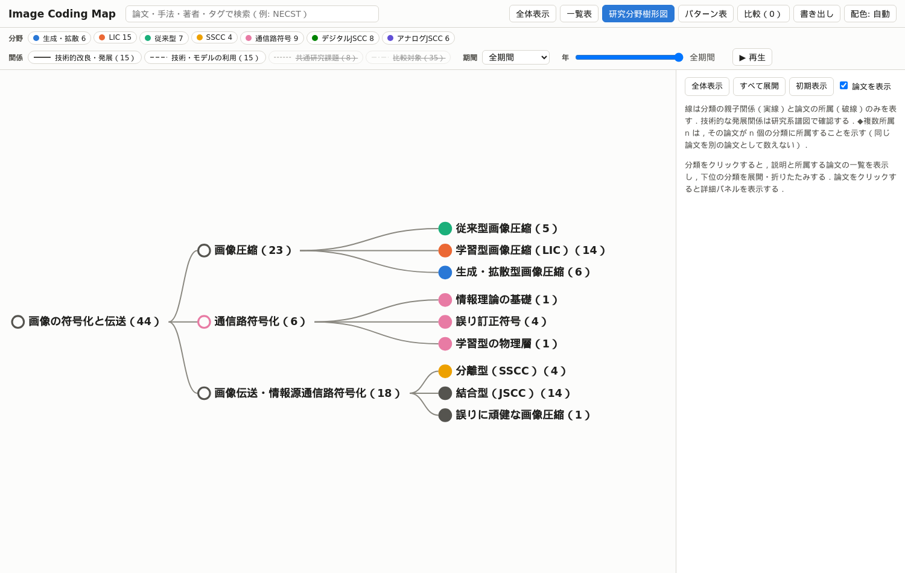
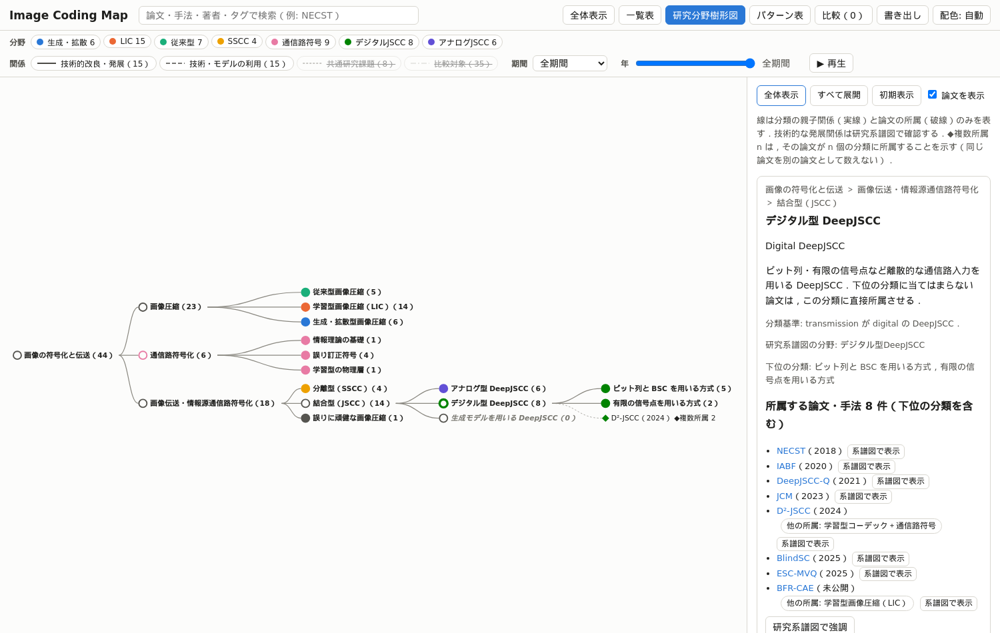
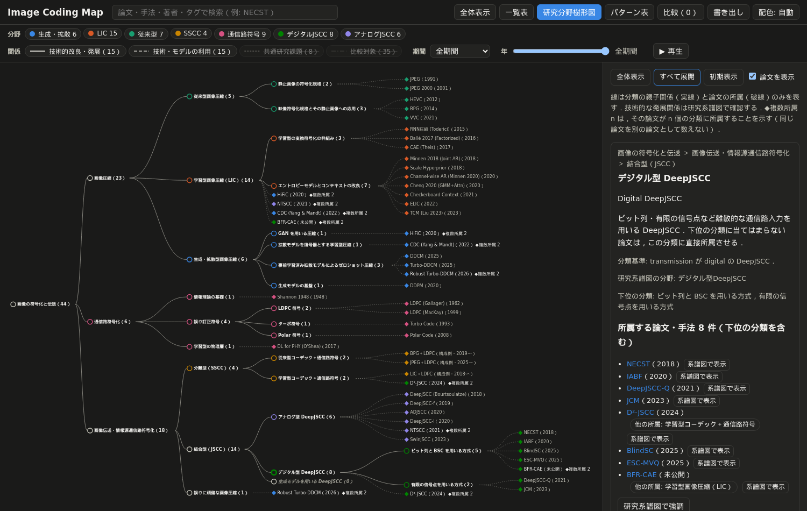
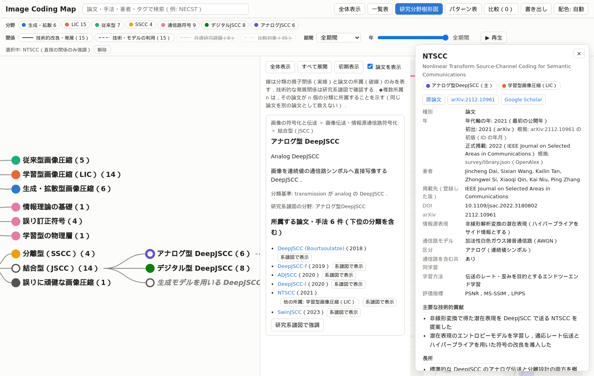
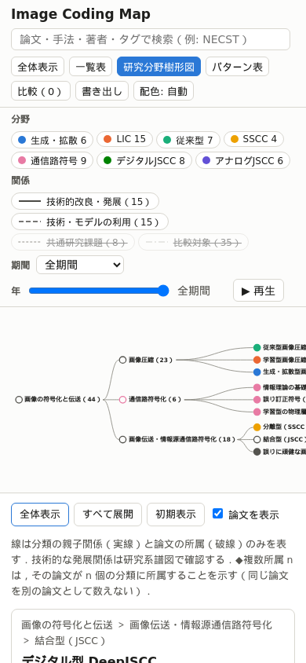

# report_007：研究分野樹形図の設計と実装

本レポートは，order_007 に基づき，Image Coding Map に研究分野の分類を階層で表示する「研究分野樹形図」を追加した結果をまとめたものである．分類の詳細は `docs/research_taxonomy.md` に記載した．commit・push・デプロイは行っていない．

## 1. 実施した変更

| 区分 | ファイル | 内容 |
| :--- | :--- | :--- |
| 分類体系 | `data/research_taxonomy.json`（新規） | 31件の分類（ID，日本語名，英語名，説明，親，子，分類基準，表示順序，対応する分野，所属の条件） |
| 論文データ | `data/nodes/*.json`（44件） | `research_fields`（所属する分類の ID の配列）を追加．論文情報は複製していない |
| スキーマ | `data/schema/node.schema.json` | `research_fields` を必須キーとして追加 |
| 検証 | `tools/taxonomy.py`（新規），`tools/validate_data.py`，`tools/common.py` | 分類体系と所属の検証，分類ごとの所属の集計 |
| 生成 | `tools/build_graph.py`，`tools/stamp_assets.py` | `graph.json` に分類体系を含める．`tree.js` の参照にもハッシュを付ける |
| サイト | `site/assets/tree.js`（新規），`site/assets/app.js`，`site/index.html`，`site/assets/style.css` | 研究分野樹形図の表示モード |
| テスト | `tests/test_taxonomy.py`（新規，13件），`tests/test_site.py`（10件追加），`tests/test_validate_data.py` | 下記 |
| 文書 | `docs/research_taxonomy.md`（新規），`README.md`，`document.md` | 分類体系の設計，操作方法，ファイル構成 |

## 2. 分類設計の判断理由

既存の7分野（`data/domains.json`）は研究系譜図の列・色・フィルタに用いており，樹形図のために変更すると系譜図の表示が変わるため，分野はそのまま残し，樹形図の分類を別のデータとして定義した．分類の多くは既存の分野の1つに対応させ，分野フィルタとの対応を保った．
根の下に order_007 の3領域（画像圧縮，通信路符号化，画像伝送・情報源通信路符号化）を置き，下位の分類は既存のノードの検証済みの記述（主要な貢献，学習方法，通信路モデル，区分）で区別できる違いに基づいて定めた．論文の無い分類は，order_004 で実在を確認した論文がある「生成モデルを用いる DeepJSCC」のみとし，収録0件と明示した．

order_007 の分類上の注意への対応は以下の通りである．

| 注意 | 対応 |
| :--- | :--- |
| JPEG は画像圧縮，LDPC は通信路符号 | JPEG は画像圧縮 ＞ 従来型 ＞ 静止画像の符号化規格，LDPC は通信路符号化 ＞ 誤り訂正符号 ＞ LDPC 符号 |
| JPEG＋LDPC は分離型の構成例 | 画像伝送 ＞ 分離型（SSCC）＞ 従来型コーデック＋通信路符号．従来型画像圧縮には所属させない |
| LIC と DeepJSCC は排他的でない | NTSCC をアナログ型 DeepJSCC と LIC の両方に所属させた |
| 生成・拡散型は学習型と重複する場合がある | HiFiC・CDC を生成型の下位分類と LIC の両方に所属させた |
| 生成モデルを用いる DeepJSCC が存在する | 結合型（JSCC）の下に分類を設け，収録0件と明示した |
| DDCM 系を無条件に DeepJSCC に置かない | 生成・拡散型 ＞ ゼロショット圧縮に置き，Robust Turbo-DDCM は「誤りに頑健な画像圧縮」（通信路を含む学習を行わない）にも所属させた．結合型の所属の条件（`joint_channel_training` が false でない）により，DeepJSCC の配下に置くと検証でエラーになる |
| BFR-CAE はデジタル型 DeepJSCC | BSC を含む共同学習を前提に「ビット列と BSC を用いる方式」に置き，LIC にも所属させた |
| 研究分野の所属と技術的な派生を混同しない | 樹形図の線は分類の親子関係と所属のみとし，派生関係は研究系譜図で表す．画面と文書に明記した |

## 3. UI と操作方法

ツールバーに「研究分野樹形図」を追加した．D3.js の `d3.tree` で左から右へ広がる樹形図を描く（図1〜図5）．

- 初期表示は根・3領域・その直下の9分類であり，下位の分類と論文は展開で段階的に表示する．
- 分類をクリックすると展開・折りたたみと，右側の欄への説明・英語名・分類基準・上位の経路・対応する研究分野・所属する論文の一覧（下位の分類を含む）の表示を行う．
- ドラッグで移動し，マウスホイールで拡大・縮小する．「全体表示」「すべて展開」「初期表示」と「論文を表示」の切り替えを設けた．展開した分類が画面外に出る場合は，見える位置へ自動で移動する．
- 分類は対応する研究分野の色で表示し，分野を持たない上位・横断的な分類は灰色とした．折りたたまれた分類は塗りつぶし，展開した分類は輪郭のみで表示する．論文は菱形で表示する．
- 重なりを防ぐため，列の幅をその階層のラベルの実測の最大幅から決め，線は親のラベルの右端から引く．
- スマートフォンの幅では樹形図の下に説明欄を置き，全体表示の縮小を 0.6 倍までに留める．











## 4. 既存機能との連携

- **詳細パネル**：樹形図・一覧の論文をクリックすると既存の詳細パネルを表示する．パネルを開いている間は樹形図の表示領域をパネルの幅だけ詰め，樹形図と一覧を引き続き操作できるようにした（ブラウザテストで，パネルが一覧のボタンを覆う不具合を検出して修正した）．
- **研究系譜図**：一覧の「系譜図で表示」で系譜図へ移動して論文を選択する．「研究系譜図で強調」で分類に所属する論文を強調する（パターン表と同じ強調の仕組みを用いた）．
- **検索**：樹形図を開いている間に検索すると，一致した論文の所属する分類を展開して強調する．略称と完全に一致する検索でも強調する．
- **絞り込み**：表示期間・年スライダー・分野の絞り込みを，表示する論文と件数に反映する．
- **複数所属**：同じ論文は所属する分類ごとに表示するが，件数は重複を除いて数え，「◆複数所属 n」と「他の所属」で同じ論文であることを示す．
- パターン表・比較・一覧表とは同じ表示の切り替え（`setView`）を用いており，いずれか1つの画面を表示する．

## 5. データ検証・ブラウザテストの結果

```text
[sync] 不一致 0 件，エラー 0 件
[warn]  d2jscc.json: joint_channel_training が未確認（jscc_requires_joint_training）
[validate] nodes=44 edges=73 errors=0 warnings=1
[build] site/data/graph.json: nodes=44 edges=73
[stamp] app.js?v=fe6cb94fa3 style.css?v=3bbd56e7fe
87 passed in 42.80s
```

テストは64件から87件になった（`tests/test_taxonomy.py` 13件，`tests/test_site.py` 10件）．order_007 の検証項目との対応を示す．

| 検証項目 | テスト |
| :--- | :--- |
| 1. 分類 ID の一意性 | `test_duplicate_category_id` |
| 2. 親子関係の循環 | `test_cycle_detection` |
| 3. 存在しない分類への参照 | `test_missing_parent_and_child`，`test_undefined_category_reference`，`test_parent_children_mismatch` |
| 4. 分類と論文ノードの参照の整合 | `test_real_data_valid`，`test_domain_consistency`，`test_member_conditions`，`test_ancestor_and_descendant`，`test_child_domain_must_match_parent`，`test_academic_constraints` |
| 5. 複数分類への所属の表示 | `test_multi_membership_counted_once`，`test_tree_category_list_and_multi_membership`，`test_tree_expand_all_counts` |
| 6. 展開・折りたたみ | `test_tree_initial_view`，`test_tree_expand_collapse` |
| 7. 分類の選択と論文一覧の連動 | `test_tree_category_list_and_multi_membership` |
| 8. 論文詳細・研究系譜図への移動 | `test_tree_paper_detail_and_map`，`test_tree_highlight_on_map` |
| 9. ライト・ダーク | `test_tree_no_overlap_and_contrast[light／dark]`（すべて展開した状態でノードとラベルの重なりが無く，文字の対比が 4.5 以上） |
| 10. `/image-coding-map/` での動作 | `tests/test_site.py` の全テスト（サブパスで配信） |
| 11. 既存の系譜図・パターン表・比較 | 既存の64件 |
| 検索・絞り込み・スマートフォン | `test_tree_search_and_filter`，`test_tree_mobile` |

## 6. 未解決事項と今後の改善候補

- D²-JSCC は `joint_channel_training` が未確認であり，結合型の条件を「false でない」としている．本文の確認で false と判明した場合は結合型から外す．
- 「生成モデルを用いる DeepJSCC」は収録0件である．order_004 で追加推奨とした CDDM，DiffJSCC，SGD-JSCC，Generative JSCC を収録すると，この分類に所属する．
- LIC の下位の分類は既存の論文の範囲で設けたため，HiFiC・CDC・NTSCC・BFR-CAE は LIC に直接所属している．知覚最適化・可変レート・変換の骨格などの分類は，論文の追加に合わせて検討する．
- 結合型（JSCC）には古典的な JSCC の論文が無く，現在の配下は DeepJSCC のみである．
- スマートフォンの幅では，凡例（分野・関係・期間）が画面の上部を大きく占め，樹形図の領域が狭い．凡例の折りたたみは既存の UI に関わるため，今回は変更していない．
- 樹形図の展開の状態は URL に保存していない．
