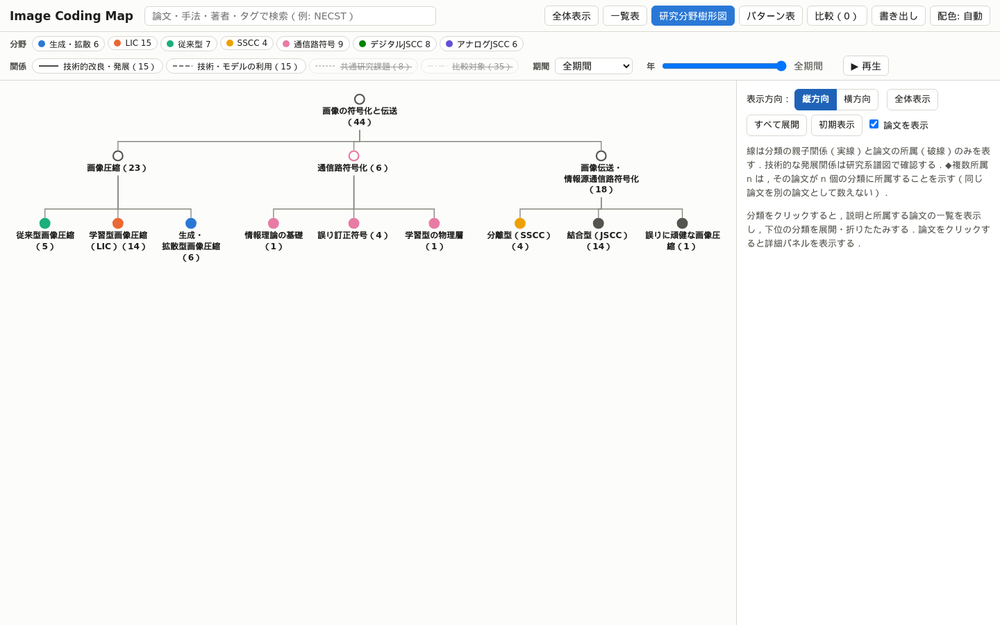
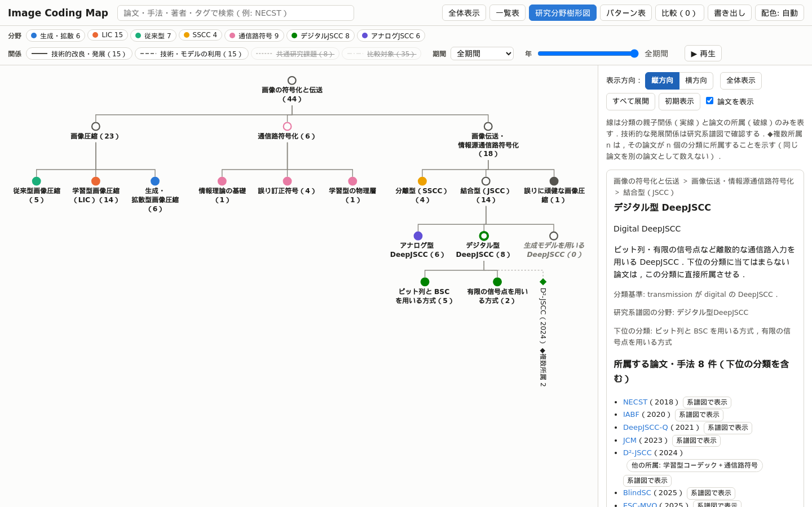
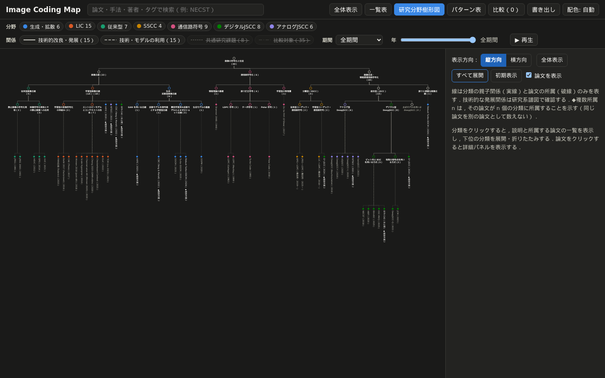
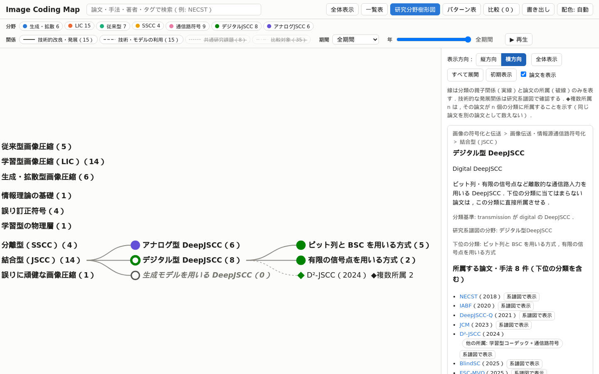
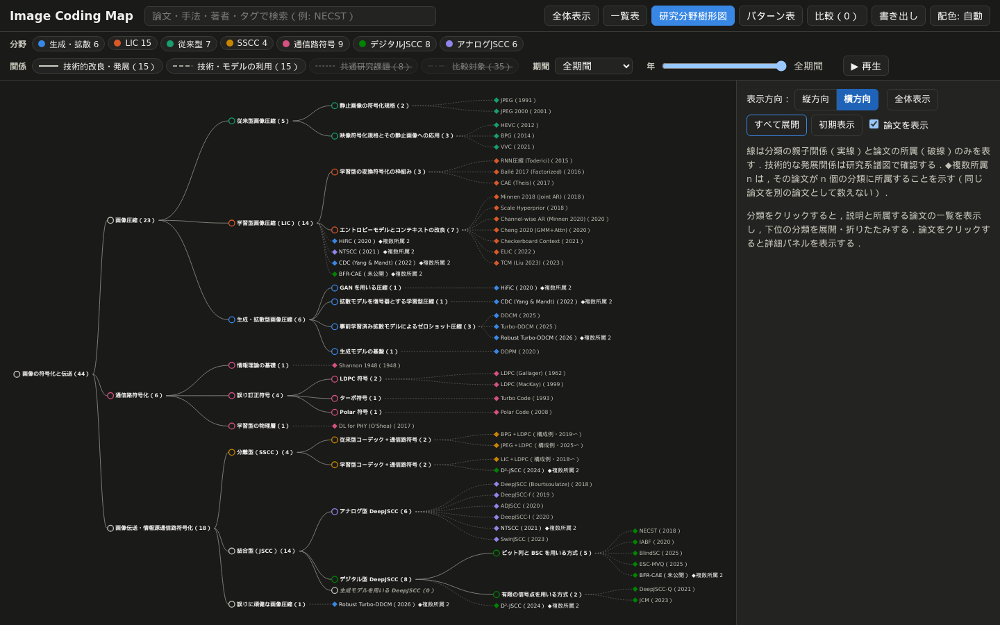
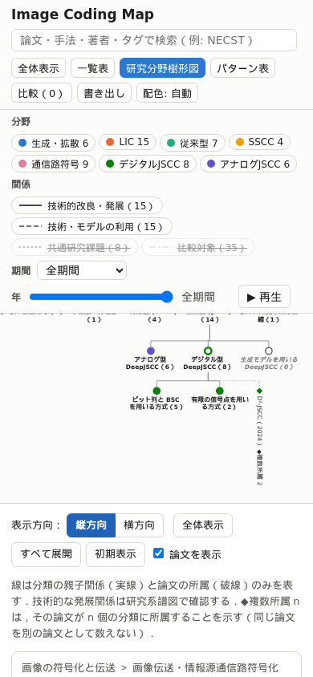
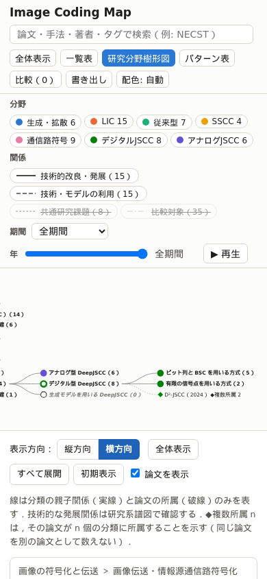

# report_009：研究分野樹形図の縦方向・横方向の切り替え

本レポートは，order_009 に基づき，研究分野樹形図に縦方向（上から下）と横方向（左から右）の表示の切り替えを実装した結果をまとめたものである．縦方向を初期表示とした．分類体系（`data/research_taxonomy.json`）と論文データは変更していない．commit・push・デプロイは行っていない．

## 1. 変更したファイル

| ファイル | 変更 |
| :--- | :--- |
| `site/assets/tree.js` | 表示方向ごとの配置の定義 `ORIENTATIONS`（縦方向・横方向）を追加し，描画処理（`render`）を両方向で共通化した．分類名の折り返し `wrapLabel`，方向の切り替え `setOrientation` と切り替えの UI `orientationControl`，方向によらない画面内への移動 `reveal`／`shiftAxis`，選択中の論文の印 `markSelectedPaper` を追加した．`fit` は方向に応じて根の位置を合わせる |
| `site/assets/app.js` | 樹形図に選択中の論文（`selectedPaper`）を渡し，詳細パネルの更新時に樹形図の印を更新する（2行） |
| `site/assets/style.css` | 表示方向の切り替え（区切られた2つのボタン）と，選択中の論文の印のスタイル |
| `site/index.html` | ビルド時に付く JS・CSS の参照のハッシュのみの変更 |
| `tests/test_site.py` | 樹形図の重なりの検査を両方向に一般化し，表示方向のテストを追加した（第6章） |
| `programs/screenshots/tree_orientation.py`（新規） | 両方向の表示の撮影（図1〜図7） |
| `README.md`，`document.md` | 操作方法，`tree.js` の関数の関係，撮影の方法，テストの件数 |

研究系譜図・パターン表・比較・一覧表の描画処理は変更していない．`app.js` の変更は樹形図への選択状態の受け渡しのみである．

## 2. レイアウト切り替えの実装方法

従来の横方向の配置の処理を `ORIENTATIONS.horizontal` に移し，同じ形式で `ORIENTATIONS.vertical` を定義した．各方向の定義は以下の4つの要素のみを持つ．

| 要素 | 内容 | 横方向 | 縦方向 |
| :--- | :--- | :--- | :--- |
| `layout(h, d3)` | 各ノードの表示座標 `(px, py)` を決める | 従来の処理（`d3.tree` の行の位置と，深さごとのラベルの最大幅による列の位置） | 第3章 |
| `linkPath(l)` | 親子を結ぶ線のパス | 親のラベルの右端から子へ曲線（従来と同じ） | 親のラベルの下から，階層の間の空白で直角に折れて子へ |
| `label(d)` | ラベルの位置と向き | ノードの右（従来と同じ） | 分類はノードの下に中央揃え，論文は 90° 回転してノードの下へ |
| `extent(d)` | ノードとラベルが占める矩形 | ノードの左端からラベルの右端まで | ラベルの幅とラベルの下端まで |

`render` は，ラベルの実測（`app.js` の `measureTreeLabel`）→ `layout` → 線・ノード・ラベルの描画の順に処理し，方向による分岐を持たない．ノードの形・色，展開の状態の表示，複数所属の表示，検索の強調，クリック・キーボード・マウスを重ねたときの処理は両方向で同じコードを用いる．ズーム・パンは同じ `d3.zoom` を用いるため，両方向で同じ操作ができる．
`reveal`（展開した分類を画面内へ移動する処理）は，従来は横方向の配置を前提として座標を直接扱っていたが，`extent` の矩形を用いて軸ごとに移動量を求める `shiftAxis` に置き換えた．範囲が画面に入らない場合の合わせ方は，横方向では親を左端・上下は中央，縦方向では親を上端・左右は親の中央とした．

## 3. 縦方向の配置アルゴリズム

1. **ラベルの行と幅**：分類名は，幅 118px を超える場合に折り返す．改行は「・」の後，「（」の前，「）」の後と空白を優先し，それでも長い部分は文字単位とする（例：「学習型画像圧縮」／「（LIC）（14）」）．論文のラベルは回転するため折り返さない．
2. **横の位置**：`d3.tree` の `nodeSize` を `[1, 1]` とし，`separation(a, b)` に隣り合う2つのノードの中心間の距離（px）を返す．距離は，2つのノードが横に占める幅の和の半分に，間隔（兄弟は 16px，親が異なる場合は 30px）を加えた値である．横に占める幅は，分類はラベルの最大幅，論文は回転したラベルの1行分（16px）とした．`d3.tree`（Reingold–Tilford 法）は隣り合う部分木の輪郭の間でこの距離を保つため，兄弟と部分木が重ならない．
3. **縦の位置**：各深さで最も下まで伸びるもの（分類はラベルの行数，論文は回転したラベルの長さ）からその深さの高さを求め，次の深さを 40px の間隔を空けて置く．同じ深さのノードは同じ高さに並ぶ．
4. **線**：親のラベルの下端から真下へ伸ばし，子の階層の上の空白で横に折れ，子のノードの上へ下ろす．縦の線は親自身の幅の範囲を通り，横の線はラベルの無い階層の間を通るため，ラベルの文字に重ならない．

ノードが増えると樹形図は横に広がり，深さが増えると下に伸びる．長い分類名は折り返すため，分類名によって横幅が極端に広がることはない．すべて展開した状態（81ノード）の大きさと，全体表示の倍率を示す（PC は 1440×900，描画領域 1060×784）．

| 状態 | 方向 | 樹形図の大きさ（px） | 全体表示の倍率 |
| :--- | :--- | :--- | :--- |
| 初期表示（13ノード） | 縦方向 | 1032 × 246 | 0.98 |
| 初期表示（13ノード） | 横方向 | 705 × 235 | 1.40（上限） |
| すべて展開（81ノード） | 縦方向 | 2609 × 1127 | 0.39 |
| すべて展開（81ノード） | 横方向 | 1669 × 1204 | 0.61 |

すべて展開した縦方向は横に長く，全体表示では文字が小さい．拡大とドラッグで閲覧する前提とした（図3）．

## 4. 展開状態・選択状態の保持方法

展開している分類（`state.expanded`），選択中の分類（`state.selected`），論文の表示の有無，検索の一致は，従来から樹形図の `state` に保持している．方向の切り替え（`setOrientation`）は `state.orientation` のみを変えて再描画し，その後 `fit` で全体を収める．このため，展開・折りたたみと選択中の分類（説明欄の内容を含む）は切り替えの前後で変わらない．
選択中の論文は，従来どおり `app.js` の `state.selected`（詳細パネルと URL のハッシュ）に保持し，樹形図の再描画の影響を受けない．樹形図では選択中の論文の菱形とラベルを強調する（`selected`）．切り替えの UI の要素は再描画で作り直すため，キーボードで切り替えた場合は新しい方向のボタンにフォーカスを戻す．
既存の URL には表示画面や表示方向の指定が無いため，表示方向は URL に保存せず，再読み込みで縦方向に戻る．

## 5. UI

樹形図の説明欄の先頭に「表示方向：［縦方向｜横方向］」を置いた．`role="radiogroup"` の中の2つの `role="radio"` のボタンであり，選択中の方向は `aria-checked="true"` と濃い青の背景・白の太字で示す．
既存のボタンの青（`--accent`）は白文字との対比が 4.42 であり，基準の 4.5 に満たないため，このボタンのみ濃い青（`#1f63b8`）とした．既存のボタンの配色は変更していない．
キーボードでは，Tab で選択中の方向へ移り，矢印キーで方向を切り替える．Enter・Space でも選択できる．切り替えは樹形図の説明欄にのみあり，樹形図を閉じると表示されない．

## 6. PC・スマートフォンでの動作確認















- PC（1440×900）では，初期表示（図1）は全体が描画領域に収まる．展開した分類は画面内へ移動し（図2，図4），すべて展開した状態は全体表示で収まる（図3，図5）．
- スマートフォンの幅（390×844）では，図6・図7の通り両方向とも切り替え・展開・論文の選択ができる．全体表示の倍率の下限は従来どおり 0.6 であり，樹形図の一部は描画領域の外になるため，ドラッグで移動して閲覧する．
- 作業中に，詳細パネルを開いた状態で横方向に切り替えると全体が収まらない不具合を確認した．パネルで描画領域の幅が 596px に狭まり，スマートフォン向けの倍率の下限（描画領域の幅が 600px 未満で 0.6）が PC でも働いていた．スマートフォンかどうかを画面全体の幅で判定するように修正した．

## 7. テスト結果

```text
[sync] 不一致 0 件，エラー 0 件
[validate] nodes=44 edges=73 errors=0 warnings=1
[build] site/data/graph.json: nodes=44 edges=73
[stamp] app.js?v=3b19062304 style.css?v=eb36b9e626
102 passed in 24.97s
```

テストは91件から102件になった．既存の樹形図のテスト `test_tree_no_overlap_and_contrast` は，ラベルが右に伸びる横方向の配置を前提として重なりを判定していたため，縦方向を初期表示にしたことで失敗した．このテストは，各ノードの描画上の矩形（回転したラベルを含む）で判定するように一般化し，方向（縦・横）と配色（ライト・ダーク）の4通りで実行するようにした．対比の検査には，分類のラベルと表示方向のボタンを加えた．その他の既存のテストは変更していない．
order_009 の検証項目との対応を示す．

| 検証項目 | テスト |
| :--- | :--- |
| 1. 初期表示が縦方向 | `test_tree_initial_orientation_is_vertical`（再読み込みで縦方向に戻ることを含む） |
| 2. 縦方向で子が親より下 | 同上，`test_tree_horizontal_places_children_right`（すべて展開した状態） |
| 3. 横方向で子が親より右 | `test_tree_horizontal_places_children_right` |
| 4. 縦 → 横，横 → 縦の切り替え | `test_tree_switch_keeps_expansion_and_selection`，`test_tree_orientation_keyboard` |
| 5. 展開・折りたたみの保持 | `test_tree_switch_keeps_expansion_and_selection`（展開と折りたたみの両方） |
| 6. 選択中の分類・論文の保持 | 同上（説明欄，詳細パネル，URL のハッシュ，樹形図の印） |
| 7. 重なりが無い | `test_tree_no_overlap_and_contrast[light／dark-vertical／horizontal]`（すべて展開した状態） |
| 8. ズーム・パン・全体表示 | `test_tree_zoom_pan_fit[vertical／horizontal]` |
| 9. PC・スマートフォン | `test_tree_mobile_orientation[vertical／horizontal]`，`test_tree_mobile` |
| 10. ライト・ダーク | `test_tree_no_overlap_and_contrast`（文字の対比 4.5 以上） |
| 11. 既存の系譜図・パターン表・比較 | 既存のテスト，`test_tree_orientation_only_in_tree_view` |
| 12. `/image-coding-map/` での表示 | `tests/test_site.py` の全テスト（サブパスで配信） |

## 8. 残っている問題点と今後の改善候補

- すべて展開した縦方向は横幅が約 2600px となり，PC の全体表示では倍率 0.39 で文字が小さい．論文のラベルを回転して横幅を抑えているが，読むには拡大が必要である．論文の葉を分類ごとにまとめて縦に並べる方式などが考えられる．
- 縦方向の論文のラベルは 90° 回転しており，日本語の文字も横倒しになる．現在の論文のラベルは略称（英字）と年が主であるため，回転を採用した．
- 分類名の折り返しは文字単位になる場合がある（例：「誤りに頑健な画像圧」／「縮（1）」）．
- スマートフォンの幅では，凡例が画面の上部を占めるため樹形図の領域が狭い（report_007 から継続）．
- 表示方向は URL に保存していない．既存の URL に表示画面の指定が無いためであり，共有した URL は縦方向で開く．
- 横方向の初期表示の全体表示は，従来どおり倍率の上限 1.4 で表示する．
