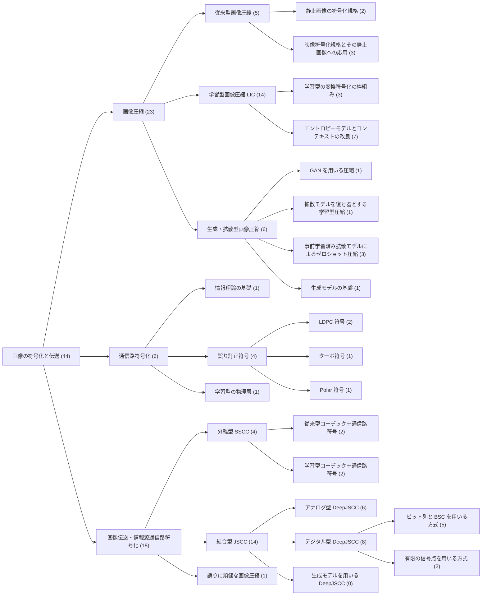

# 研究分野樹形図の分類体系

本文書は，Image Coding Map の「研究分野樹形図」で用いる分類体系の設計を記録する．分類の定義は `data/research_taxonomy.json` で管理し，論文ノードは `research_fields` で所属する分類の ID を参照する．論文の情報を樹形図のために複製しない．

研究系譜図が論文間の技術的な発展関係（`derived_from`，`builds_on` 等）を表すのに対し，樹形図は研究分野の分類と，各分類への論文の所属のみを表す．樹形図の線は分類の親子関係と所属であり，技術的な派生・継承を意味しない．

## 1. 全体像

根の下に3つの領域を置き，既存の44ノードの内容に基づいて下位の分類を定めた．括弧内は所属する論文・手法の数（下位の分類を含み，重複を除く）である．

分類は31件（根1，領域3，第2階層9，第3階層以下18），最も深い階層は4である．

## 2. 設計の方針

- **3領域**：order_007 の指定に従い，画像圧縮（情報源符号化），通信路符号化，画像伝送・情報源通信路符号化を根の直下に置いた．画像伝送は，画像圧縮と通信路符号化を組み合わせる研究の領域である．
- **既存の分野との対応**：既存の7分野（`data/domains.json`）は研究系譜図の列・色・フィルタに用いており，変更しない．分類の多くは既存の分野の1つに対応する（`domain`）．分野を持つ分類の子は同じ分野を持つ．画像圧縮・画像伝送・結合型（JSCC）・生成モデルを用いる DeepJSCC・誤りに頑健な画像圧縮は，複数の分野にまたがるか既存の分野に対応しないため，分野を持たない（`domain: null`）．樹形図の色は対応する分野の色であり，分野を持たない分類は灰色とした．
- **階層の決め方**：下位の分類は，既存のノードの検証済みの記述（主要な貢献，学習方法，通信路モデル，区分）で判断できる違いに基づいて設けた．所属が1件の分類も，分類上の区別が明確な場合（例: ターボ符号，Polar 符号）は設けた．見栄えのために論文の無い分類は設けていない．例外は「生成モデルを用いる DeepJSCC」であり，order_004 の監査で API により実在を確認した論文（CDDM，DiffJSCC，SGD-JSCC，Generative JSCC）があるため，収録0件と明示して設けた（`allow_empty: true`）．
- **所属の条件**：分類によっては，所属する論文が満たすべき条件を `member_conditions` に定義し，下位の分類にも適用する．例えば結合型（JSCC）は `joint_channel_training` が false でないこと，アナログ型 DeepJSCC は `transmission` が analog であること，誤りに頑健な画像圧縮は `joint_channel_training` が false であることを条件とする．これにより，DDCM 系を DeepJSCC の配下に置くと検証でエラーになる．

## 3. 各分類の定義と判断基準

| 分類 | 対応する分野 | 定義（要点） | 判断基準（要点） | 所属する論文・手法 |
| :--- | :--- | :--- | :--- | :--- |
| 画像圧縮 | － | 画像を少ないビット数で表す情報源符号化．通信路の誤りは扱わない | 主要な貢献が圧縮方式 | （下位の分類） |
| 従来型画像圧縮 | 従来型 | 手設計の変換・予測・エントロピー符号化 | 学習を用いない（条件: `training` が「学習なし」） | （下位の分類） |
| 静止画像の符号化規格 | 従来型 | 静止画像を対象とする符号化規格 | 静止画像の規格（の解説論文） | JPEG，JPEG 2000 |
| 映像符号化規格とその静止画像への応用 | 従来型 | 映像符号化規格と，そのイントラ符号化に基づく画像形式 | 映像符号化規格，またはそれに基づく画像形式 | HEVC，VVC，BPG |
| 学習型画像圧縮（LIC） | LIC | 変換とエントロピーモデルをレート・歪みで学習する圧縮 | 符号化器・復号器を学習しレートと歪みを目的とする．下位に当てはまらないものは直接所属 | HiFiC，CDC，NTSCC，BFR-CAE（他の分類と重複） |
| 学習型の変換符号化の枠組み | LIC | 変換符号化の全体を学習可能にした初期の枠組み | 改良パターン「変換符号化の学習化」に該当 | Toderici（RNN），Ballé 2017，CAE（Theis） |
| エントロピーモデルとコンテキストの改良 | LIC | 確率モデルの構造と，その逐次処理の効率化 | 主要な貢献がエントロピーモデルの構造または逐次処理の削減 | Scale Hyperprior，Minnen 2018，Cheng 2020，Channel-wise AR，Checkerboard，ELIC，TCM |
| 生成・拡散型画像圧縮 | 生成・拡散 | 生成モデルを復号・符号化に用いる圧縮．DeepJSCC の下位分類ではない | 生成モデルを圧縮の手段として用いる | （下位の分類） |
| GAN を用いる圧縮 | 生成・拡散 | 敵対的学習による生成的な復号器 | 採用技術「敵対的学習」を復号器に用いる | HiFiC |
| 拡散モデルを復号器とする学習型圧縮 | 生成・拡散 | 潜在表現を条件として拡散モデルで復号する | 拡散モデルを復号器とし，符号化器・復号器を学習する | CDC |
| 事前学習済み拡散モデルによるゼロショット圧縮 | 生成・拡散 | 追加学習なしで拡散モデルの雑音の選択（符号帳）で表す | 採用技術「事前学習済みモデルのゼロショット利用」（条件: `training` が「事前学習済み」で始まる） | DDCM，Turbo-DDCM，Robust Turbo-DDCM |
| 生成モデルの基盤 | 生成・拡散 | 生成・拡散型圧縮の基盤となる生成モデル．それ自体は圧縮方式ではない | 生成モデルの基礎研究で，生成型圧縮が部品として用いる | DDPM |
| 通信路符号化 | 通信路符号 | 雑音のある通信路での誤りの訂正・抑制と，その理論・関連技術 | 主要な貢献が符号・復号・容量の理論・送受信機の設計 | （下位の分類） |
| 情報理論の基礎 | 通信路符号 | 情報量・通信路容量・符号化定理．特定の SSCC の実装方式ではない | 符号化定理・通信路容量を示す理論研究 | Shannon 1948 |
| 誤り訂正符号 | 通信路符号 | 容量に近い性能を目指す符号の族と復号法 | 改良パターン「通信路符号の構成・復号の改良」に該当 | （下位の分類） |
| LDPC 符号 | 通信路符号 | 疎なパリティ検査行列の符号と確率伝播の復号 | LDPC 符号の構成・復号・性能 | LDPC（Gallager），LDPC（MacKay） |
| ターボ符号 | 通信路符号 | 再帰的組織畳み込み符号の並列連接と反復復号 | ターボ符号の構成・復号 | Turbo Code |
| Polar 符号 | 通信路符号 | 通信路分極による符号と逐次除去復号 | Polar 符号の構成・復号 | Polar Code |
| 学習型の物理層 | 通信路符号 | 送受信機を自己符号化器として学習する考え方 | 画像に限らない通信システムの学習 | DL for PHY（O'Shea） |
| 画像伝送・情報源通信路符号化 | － | 画像を雑音のある通信路で伝送する方式 | 通信路の雑音・誤りを受ける状況での再構成が主要な対象 | （下位の分類） |
| 分離型（SSCC） | SSCC | 情報源符号と通信路符号を独立に設計して連結する構成 | 圧縮方式と通信路符号を連結する（条件: `transmission` が digital） | （下位の分類） |
| 従来型コーデック＋通信路符号 | SSCC | 従来型コーデックと LDPC 符号等の連結 | 情報源符号化が学習なし | JPEG＋LDPC，BPG＋LDPC |
| 学習型コーデック＋通信路符号 | SSCC | 学習型の情報源符号化と通信路符号の連結．レートの共同最適化を含む | 情報源符号化が学習型で，通信路符号を別に用いる | LIC＋LDPC，D²-JSCC |
| 結合型（JSCC） | － | 情報源符号化と通信路符号化を結合して設計する方式（主に DeepJSCC） | 通信路を含む共同学習（条件: `joint_channel_training` が false でない） | （下位の分類） |
| アナログ型 DeepJSCC | アナログ JSCC | 連続値の通信路シンボルへの直接の写像 | 条件: `transmission` が analog | DeepJSCC（Bourtsoulatze），DeepJSCC-f，DeepJSCC-l，ADJSCC，NTSCC，SwinJSCC |
| デジタル型 DeepJSCC | デジタル JSCC | 離散的な通信路入力を用いる DeepJSCC | 条件: `transmission` が digital．下位に当てはまらないものは直接所属 | D²-JSCC（直接） |
| ビット列と BSC を用いる方式 | デジタル JSCC | 二値の潜在符号・符号帳のインデックスを BSC を含めて学習 | 条件: `channel_models` に BSC を含む | NECST，IABF，BlindSC，ESC-MVQ，BFR-CAE |
| 有限の信号点を用いる方式 | デジタル JSCC | 有限の変調の信号点への写像を学習 | 通信路入力が有限の信号点 | DeepJSCC-Q，JCM |
| 生成モデルを用いる DeepJSCC | － | 生成モデルを DeepJSCC の復号・雑音除去に用いる | DeepJSCC であり生成モデルを用いる | 収録なし（order_004 で実在を確認した論文あり） |
| 誤りに頑健な画像圧縮 | － | 通信路を含む共同学習を行わずに，ビット列の誤りへの頑健性を扱う | ビット誤りへの頑健性が主要な課題（条件: `joint_channel_training` が false） | Robust Turbo-DDCM |

## 4. 分野の重複の扱い

純粋な木では1つの論文を1つの分類にしか置けないため，以下の方法で重複を表した．

- **複数所属**：論文は `research_fields` に複数の分類を持てる．複数所属の論文は6件である．

  | 論文 | 所属 | 理由 |
  | :--- | :--- | :--- |
  | NTSCC | アナログ型 DeepJSCC，LIC | LIC のハイパープライアを DeepJSCC に導入しており，LIC と DeepJSCC が排他的でないことを表す |
  | HiFiC | GAN を用いる圧縮，LIC | 生成型圧縮であり学習型圧縮でもある |
  | CDC | 拡散モデルを復号器とする学習型圧縮，LIC | 同上 |
  | BFR-CAE | ビット列と BSC を用いる方式，LIC | BSC を含めた共同学習を前提にデジタル型 DeepJSCC に位置付け，圧縮自己符号化器として LIC にも所属する |
  | D²-JSCC | デジタル型 DeepJSCC，学習型コーデック＋通信路符号 | 学習型の情報源符号と Polar 符号を分けたうえでレートを共同最適化しており，結合型と分離型の両方の性格を持つ |
  | Robust Turbo-DDCM | ゼロショット圧縮，誤りに頑健な画像圧縮 | 拡散型圧縮であり，ビット誤りへの頑健性を扱うが，通信路を含む共同学習を行わないため DeepJSCC には置かない |

- **重複の除外**：上位の分類の件数は，子孫の分類の所属を合わせて重複を除いて数える（例: D²-JSCC は分離型と結合型の両方に所属するが，画像伝送では1件と数える）．樹形図では複数所属の論文に「◆複数所属 n」を表示し，マウスを重ねると同じ論文の他の位置も強調する．分類の一覧には「他の所属」を表示する．
- **構成例と分野**：JPEG＋LDPC 等の構成例は研究系譜図では SSCC・従来型・通信路符号の3分野に属するが，樹形図では分離型（SSCC）にのみ所属させた．JPEG＋LDPC は画像圧縮方式ではなく分離型の伝送システムの構成例だからである．そのため，所属する分類の分野は論文の `domains` に含まれることと，主分野（`domains` の先頭）がいずれかの所属で表されることを検証し，全ての分野が表されることは求めない．

## 5. 曖昧さと注意事項

- **学習型画像圧縮への直接の所属**：HiFiC，CDC，NTSCC，BFR-CAE は LIC の下位の分類（変換符号化の枠組み，エントロピーモデル）のいずれにも当てはまらないため，LIC に直接所属させた．LIC の下位の分類は既存の論文の範囲で設けたものであり，知覚最適化・可変レート等の分類は今後の論文の追加に合わせて検討する．
- **エントロピーモデルの分類と TCM**：TCM は変換の骨格（Transformer-CNN 混合）とエントロピーモデルの両方を提案している．LIC の下位には「変換の骨格」の分類を設けていないため，エントロピーモデルの分類に置いた．
- **D²-JSCC の通信路を含む学習**：D²-JSCC は `joint_channel_training` が未確認（null）であり，結合型の条件は「false でない」としている．本文の確認で false と判明した場合は，結合型から外す必要がある．
- **DeepJSCC と JSCC**：結合型（JSCC）には古典的な（学習を用いない）JSCC も含まれるが，既存のデータには該当する論文が無い．現在の配下は DeepJSCC のみである．
- **研究分野の所属と技術的な派生の区別**：例えば Turbo-DDCM は DDCM から派生している（研究系譜図の `derived_from`）が，樹形図では両者は同じ分類に所属しているだけであり，親子関係は無い．派生関係は研究系譜図で確認する．
- **年代による変化**：分類は既存のデータ（2026年11月時点の44ノード）に基づく．論文を追加して1つの分類に多くの論文が集まった場合は，下位の分類を設ける．

## 6. 拡張の手順

1. 新しい論文の `research_fields` に所属する分類の ID を書く．複数の分野にまたがる場合は複数書く（分類とその祖先の両方には書かない）．
2. 既存の分類で表せない分野が複数の論文に現れた場合に，`data/research_taxonomy.json` に分類を追加する．ID，日本語名，英語名，説明，親，子，分類基準，表示順序，対応する分野を記入し，親の `children` にも追加する．必要なら所属の条件を記入する．
3. `python tools/validate_data.py` で，ID の重複，親子の不整合・循環，存在しない分類への参照，分野との対応，所属の条件を検査する．描画コードの変更は不要である．
