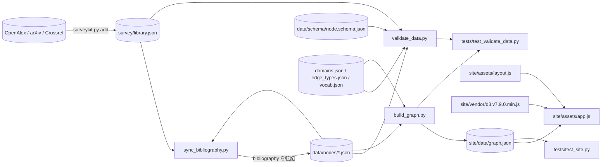
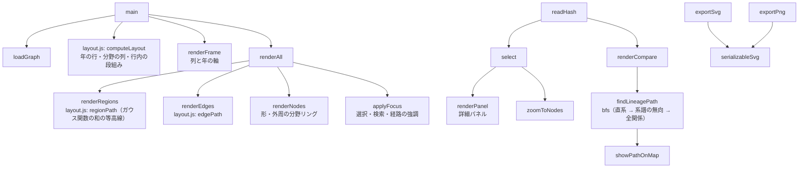

# image-coding-map（Image Compression Map）

画像圧縮・DeepJSCC・通信路符号の研究系譜を可視化する静的Webサイトと，その論文データ・検証ツールのプロジェクトである．
公開用のリポジトリ名は `image-compression-map` を想定している．サイトの機能，データ形式，論文の追加手順は `README.md` に記載する．

## ディレクトリとファイルの役割

| パス | 役割 |
| :--- | :--- |
| `data/nodes/<id>.json` | 論文・手法ごとの一次データ（44件） |
| `data/domains.json` | 研究分野の定義（ラベル，説明，ライト／ダークの色，列の順） |
| `data/edge_types.json` | エッジ種別の定義（向き，系譜かどうか） |
| `data/vocab.json` | 種別・通信路モデル・根拠・確認範囲の表示名 |
| `data/schema/node.schema.json` | ノードの JSON スキーマ（Draft 2020-12） |
| `survey/library.json` | OpenAlex・arXiv・Crossref から取得した書誌情報（39件）．`surveykit.py` のみが編集する |
| `survey/search_log.json`，`survey/plan.md` 等 | ai-survey-kit の `init` が作成した取得の記録と雛形 |
| `tools/common.py` | JSON・ライブラリの読み込み，掲載先名の整理，書誌情報の変換 |
| `tools/sync_bibliography.py` | `library.json` の書誌情報をノードの `bibliography` へ転記する．`--check` で照合のみ行う |
| `tools/validate_data.py` | データ検証（スキーマ，ID，参照，エッジ種別，循環，書誌情報） |
| `tools/build_graph.py` | `data/` を統合して `site/data/graph.json` を生成する |
| `site/index.html`，`site/assets/*` | 配信するサイト（D3.js による描画と操作） |
| `site/vendor/` | D3.js v7.9.0（ISC License）とそのライセンス |
| `tests/test_validate_data.py` | 検証・生成と，学術的な分類の約束のテスト |
| `tests/test_site.py` | Playwright（Chromium）による表示テスト |
| `.github/workflows/pages.yml` | 検証 → 生成 → テスト → GitHub Pages へのデプロイ |
| `requirements_tools.txt` | ツール・テスト用の Python ライブラリ |
| `.orders/`，`.reports/` | 作業指示と作業報告 |

## 処理の流れと依存関係



Python のツールは `common.py` を共有し，`validate_data.py` は `sync_bibliography.diff_bibliography` を用いて書誌情報を照合する．
`build_graph.py` は検証を行わないため，CI では `validate_data.py` の後に実行する．

サイト側の主要な関数の関係を以下に示す．`app.js` は `graph.json` のみを読み，論文の内容・分野・エッジ種別をデータから決めるため，論文を追加しても JavaScript の変更は不要である．



## Python 環境の構築

ツールと表示テストの環境は `.venv_tools`（Python 3.12）である．GPU は使用しない．

```bash
uv venv -p 3.12 .venv_tools
uv pip install -p .venv_tools -r requirements_tools.txt
.venv_tools/bin/python -m playwright install chromium
.venv_tools/bin/python -m ipykernel install --user --name venv_tools --display-name "Python (.venv_tools)"
```

使用したバージョンは Python 3.12，jsonschema 4.23.0，pytest 8.3.4，playwright 1.49.1（Chromium Headless Shell 131）である．
`tools/` のスクリプトは `jsonschema`（スキーマ検証）以外は標準ライブラリのみで動作する．Node.js は不要である．

## 実行方法

```bash
.venv_tools/bin/python tools/sync_bibliography.py          # 書誌情報の転記（--check で照合のみ）
.venv_tools/bin/python tools/validate_data.py              # データ検証
.venv_tools/bin/python tools/build_graph.py                # site/data/graph.json の生成
.venv_tools/bin/python -m pytest -q tests                  # テスト（25件）
python3 -m http.server 8000 -d site                        # http://localhost:8000/ で確認
```

書誌情報を追加する場合は `python3 .ai/ai-survey-kit/scripts/surveykit.py add --title "..."` を用いる．

## 生成物と文書の保存場所

- `site/data/graph.json` はビルドの生成物であり Git 管理外である．CI で毎回生成する．
- 作業報告は `.reports/report_{n:03}.md`，作業指示は `.orders/order_{n:03}.md` にある．
- 論文の PDF は保存しない（`survey/pdfs/` は Git 管理外）．

## APIキーと設定

- 書誌情報の取得（OpenAlex，arXiv，Crossref）に API キーは不要である．`SURVEYKIT_MAILTO` を設定すると OpenAlex・Crossref の polite pool を利用できる．
- `tokens.json` は本プロジェクトでは使用しない（`.gitignore` 済み）．
- GitHub Pages は Settings → Pages の Source を GitHub Actions にする．

## Git 管理上の注意

- `.ai/` の各 kit はサブモジュールである．公開リポジトリ（`image-compression-map`）にサブモジュールを含めるかは公開時に判断する．CI はサブモジュールを必要としない．
- `survey/library.json` は検証で参照するため Git で管理する．
- 参考にした `optimizer_map` にはライセンスの表示が無く，コードは流用していない．本リポジトリのライセンスは未設定である．
